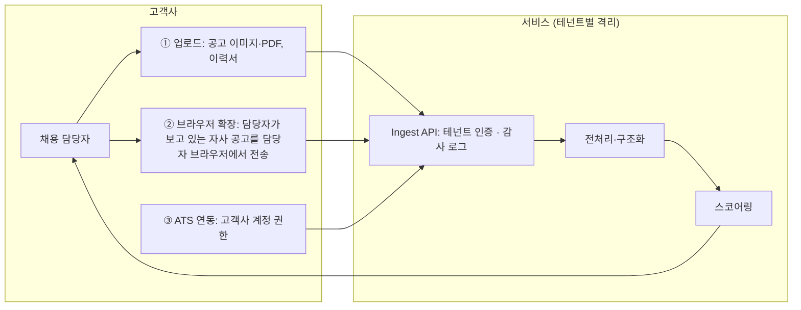

# jobfit

이미지로 된 채용공고를 수집해 이미지에서 조건을 뽑고, 지원자 풀과 매칭해 0~100점 랭킹과 근거를 보여주는 엔진. 특정 직군을 코드에 넣지 않고 공고에서 읽은 조건만으로 동작한다.

```
① 수집 (crawler)  →  ② 전처리·구조화 (preprocessing)  →  ③ 스코어링 (scoring)
   사람인 공고 페이지     이미지 분할 → 비전 LLM 전사       요건별 판정(LLM) → 인용 검증
   → 본문 이미지 스냅샷   → 요건 구조화 → 인용 검증         → 점수 집계(코드) → 랭킹·근거
```

CLI(`jobfit run`) · HTTP API · 웹 화면이 같은 서비스 함수를 호출한다. 전체 구조는 [`docs/architecture.md`](docs/architecture.md), 설계 문서·결정 기록(ADR)은 [`docs/`](docs/README.md)에 있다.

## 빠른 시작

Python 3.10 이상과 [uv](https://docs.astral.sh/uv/)가 필요하다.

```bash
git clone <repo> && cd jobfit
uv venv && source .venv/bin/activate
uv pip install -e ".[dev]"
cp .env.example .env          # OPENAI_API_KEY=… 입력 (.env는 커밋되지 않음)

jobfit run 55189170 55162188  # 수집 → 조건 추출 → 매칭, 터미널에 랭킹 출력
jobfit serve                  # http://127.0.0.1:8000 에서 결과·근거 보기
pytest                        # 네트워크·API 키 없이 188개
```

> 소스는 `src/` 바로 아래에 있고 `cli`, `settings`, `crawler` 등이 최상위 모듈로 설치된다 ([ADR-0006](docs/adr/0006-flat-src-layout.md)). 프로젝트 전용 가상환경(`.venv`)에서 실행한다.

## 문제를 어떻게 정의했나

점수를 매기는 것보다 사람이 검증할 수 있는 판정을 만드는 것이 이 서비스의 일이라고 정의했습니다. 채용 담당자는 85점이라는 숫자 하나만 보고 지원자를 거르지 않습니다. 점수가 나왔다면 공고의 어느 문장(이미지의 어느 위치)에서 나온 요건을 이력서의 어느 줄로 충족했는지까지 따라갈 수 있어야 한다고 봤습니다.

그래서 원칙을 세 가지로 잡았습니다.

1. **공고에 쓰인 것만으로 평가합니다.** 직군별 규칙은 코드에 넣지 않았고, 공고 이미지에서 읽은 요건이 그대로 평가 기준이 됩니다. 새 직군이 와도 코드는 같고 데이터만 다릅니다.
2. **판단은 LLM이, 계산은 코드가 합니다.** 판정이 같으면 점수도 항상 같아야 하고, 그 점수가 어떻게 나왔는지 설명할 수 있어야 합니다.
3. **모름과 없음을 구분합니다.** 이력서에 쓰지 않은 내용은 미충족으로 치지 않고 "확인 필요"로 남깁니다.

## 평가용 공고 두 건과 고른 이유

| | 공고 A | 공고 B |
|---|---|---|
| 공고 | S-OIL 2026 사무직 신입사원 ([55189170](https://www.saramin.co.kr/zf_user/jobs/relay/view?rec_idx=55189170)) | 오리온 청주공장 생산직 ([55162188](https://www.saramin.co.kr/zf_user/jobs/relay/view?rec_idx=55162188)) |
| 직군 | 사무직 (재무·영업·수급·공정·설비 등 모집분야 여러 개) | 식품 생산직 (배합·성형·포장) |
| 이미지 | 1장, 860×3170. 병합 셀 표, 작은 글씨, 세로로 긴 이미지 | 1장, 720×1890. 4열 표 안에 자격요건·우대사항 목록 |
| 이미지 안 요건 | 학력·졸업시기, 공인어학성적, 병역, 해외여행 결격, 모집분야별 전공, 우대(영어 회화, 엔지니어 직무 자격증) | 고졸 이상, 경력 무관, 야간근무 가능, 우대(인근 거주, 해당직무 근무경험, 국가보훈대상) |

기준은 후보 공고를 직접 받아 보면서 세웠습니다.

1. **본문이 이미지일 것.** 사람인에는 템플릿으로 쓴 텍스트 공고가 많아서(예: 반도체 협력사 생산직 55240589) 이것부터 걸렀습니다.
2. **이미지 안에 자격요건이 있을 것.** 이미지 공고인데 이미지는 안내 배너뿐이고 요강은 외부 사이트와 PDF에 있는 경우가 있었습니다(근로복지공단 울산병원 55238467). 조건은 이미지에서만 뽑기로 했기 때문에 뺐습니다.
3. **지원자를 완벽 / 부분 / 미스매치로 가를 만큼 요건이 있을 것.** 대기업 신입 공채 중에는 요건이 학력과 졸업시기 정도뿐이라 변별이 안 되는 공고도 있었습니다(신세계 그룹 신입 54975614).
4. **두 공고가 최대한 다를 것.** 비슷한 공고 두 개로는 직군과 상관없이 동작하는지 확인하기 어렵다고 봤습니다.

고르고 보니 두 공고는 거의 모든 면에서 달랐습니다.

- **직군·학력:** 사무 vs 생산, 대졸 vs 고졸.
- **요건의 성격:** A는 어학 성적이나 전공처럼 서류로 확인하는 자격이고, B는 야간근무 가능이나 인근 거주 같은 근무 조건과 경험입니다.
- **모집분야 구조:** A는 모집분야마다 전공 요건이 달라서 지원자를 어느 분야로 평가할지부터 정해야 합니다. B는 단일 직무입니다.
- **레이아웃:** 이미지 폭과 길이, 표 구조가 달라 전처리가 특정 레이아웃에 묶여 있지 않은지 볼 수 있습니다.
- **민감 항목:** B에는 국가보훈대상 우대처럼 점수에 넣으면 안 되는 법정 우대 항목이 있어서, 이걸 어떻게 다룰지도 같이 정해야 했습니다.

아쉬운 점도 있습니다. 두 공고 모두 경력 요건이 약해서(A는 신입, B는 경력 무관) 연차 계산은 이 두 건만으로 충분히 검증되지 않습니다. 경력 규칙은 코드에 없는 직군과 연차 요건을 넣은 테스트로 따로 확인했고, 정보가 적은 공고에서의 동작은 세 번째 공고(KT&G 계약사원 55240124)로 봤습니다. 선정 과정은 [ADR-0009](docs/adr/0009-evaluation-postings.md)와 [스펙 01 관찰 기록](docs/specs/2026-10-12-01-posting-crawler-design.md)에 남겨 두었습니다.

## 설계 결정과 트레이드오프

| 결정 | 왜 | 대가 |
|---|---|---|
| 수집 → 전처리·구조화 → 스코어링 3단계, 단계 사이는 파일로 주고받음 | 단계마다 따로 실험·검증할 수 있고, 수집을 고객사 업로드로 바꿔도 뒤 단계는 그대로 | 파일 형식이 바뀌면 여러 단계를 고쳐야 함 |
| 조건은 공고 이미지에서만 추출 (HTML 텍스트·숨김 키워드 미사용) | 요구사항이 "이미지 파싱 결과가 입력"이고, 숨김 SEO 키워드는 공고 작성자가 쓴 조건이 아님 | 이미지에 요건이 없는 공고는 평가 불가 → `/excluded`에 이유와 함께 따로 보여줌 |
| OCR 대신 비전 LLM, 읽기(전사)와 이해(구조화)를 분리 | 장식 폰트·표·병합 셀은 규칙으로 처리하기 어려움. 나눠 두면 틀렸을 때 잘못 읽은 건지 잘못 해석한 건지 구분할 수 있음 | 호출 1회 추가 |
| 긴 이미지는 글자 줄 사이 여백에서 1200px로 자름 | 통째로 넣으면 축소돼 없는 문장을 지어냈고, 800px는 표 행을 잘랐음 | 조각 수만큼 호출 |
| 판정마다 이력서 인용 필수, 원문에 없으면 "확인 필요"로 내림 | 환각을 막고, 사람이 근거를 따라갈 수 있음 | 인용 표기 차이로 오탐 → 공백·괄호·콜론 무시로 보정 |
| 점수 = (필수 평균×0.7 + 우대 평균×0.3) × 0.8^(필수 미충족 수) | 필수만 다 갖추면 70점. 필수 하나 미충족으로 0점이 되지 않아 판정 오류 하나에 덜 흔들림 | 상수의 근거가 약함. 목업 12명의 의도 구간으로만 확인 |
| "확인 필요"는 0.5점, 감점 배수 없음 | 이력서에 잘 안 쓰는 자격(해외여행 결격사유 없음 등) 때문에 모두가 깎이지 않게 | 정보가 적은 이력서가 유리해질 여지 |
| 법정 우대(보훈·장애인)는 점수 미반영, 이력서에서 받지 않음 | 법령과 증빙으로 전형에서 적용하는 가점이고 민감 정보 | 실제 전형 순위와 다를 수 있음 → 화면에 명시 |
| 직무 요건이 없는 공고만 모집분야 이름으로 직무 적합도 우대 요건 도출 | 공통 자격만 있으면 전원 동점 | "공고에 쓰인 것만" 원칙의 예외 → 화면에 표시하고 끌 수 있게 |
| LLM 응답을 입력 해시로 캐시 | 예산이 제한적이고 실험을 반복함. 두 번째 실행부터 비용 0 | 캐시가 커짐, 프롬프트를 바꾸면 다시 호출 |

결정마다의 맥락과 검토한 대안은 [`docs/adr/`](docs/adr/README.md)에 있습니다.

## 결과

- **조건 추출:** 공고 이미지를 보고 직접 만든 정답 요건 18개 기준으로 재현율·정밀도 100%. 이미지를 통째로 넣었을 때 S-OIL 재현율은 58%였습니다.
- **판정:** 목업마다 적어 둔 의도한 판정과 93%(38/41) 일치. 점수 구간은 완벽 매칭 93~100, 부분 매칭 52~78, 미스매치 28~34점.
- **교차 평가:** S-OIL 미스매치 지원자(화학공장 생산직 10년)가 오리온 생산직에서는 85점을 받았습니다. 라벨과 상관없이 요건으로 점수가 매겨진다는 걸 확인한 결과입니다.
- **정보가 적은 공고(KT&G):** 공통 자격만 있어서 11명이 동점이었는데, 직무 적합도 요건을 도출한 뒤 100 / 85 / 83 / 68 / 50으로 갈렸습니다.
- **비용:** 공고 3건에 모델 비교, JEV 실험까지 합쳐 API 비용은 약 $1.32입니다(`jobfit cost`, 일부 추정값 포함).
- **판단 전용 모델(JEV) 실험:**
  - 공고 2건 × 지원자 12명 매칭에 gpt-4.1은 1분 남짓, JEV는 몇 초가 걸렸습니다(약 15배). 비용은 약 47분의 1입니다.
  - 점수 순위는 gpt-4.1과 거의 같았지만(스피어만 0.91~0.97) 요건별 판정 일치는 52~83%에 그쳤고, 사유 문장도 없습니다.
  - 기본 판정은 gpt-4.1로 두고, JEV는 지원자가 수천 명일 때 1차 선별용으로 남겼습니다.

## 고객사 경유 데이터 유입 구조 (설계)

서비스가 채용 플랫폼을 직접 크롤링해 공고를 쌓으면 데이터베이스권, 부정경쟁, 약관 문제가 생길 수 있습니다. 운영 구조에서는 서비스 서버가 채용 플랫폼에 요청하지 않고, 데이터가 고객사를 거쳐 들어오게 했습니다. 데이터의 권리와 수집 주체는 고객사가 되고, 서비스는 고객사의 지시에 따라 처리만 하는 수탁자가 됩니다.



- **세 가지 유입 경로:** 업로드, 브라우저 확장(담당자 세션에서 현재 탭 보내기만 하고 자동 순회는 없음), ATS 연동. 기본 유스케이스는 고객사의 자사 공고와 자사 지원서입니다.
- **테넌트 격리:** 고객사끼리 공고·이력서·캐시를 공유하지 않습니다. 서비스 쪽에 공고 DB가 쌓이지 않습니다.
- **최소 보관:** 원본은 처리 후 일정 기간이 지나면 지우고, 구조화 결과와 매칭 결과만 남깁니다.
- **개인정보:** 식별 정보는 LLM에 보내기 전에 가립니다. 외부 LLM으로 보내는 것은 처리 위탁·국외 이전에 해당하므로 고객사가 지원자에게 하는 고지에 포함시킵니다.
- **지금 코드와의 연결:** 수집기만 Ingest API로 바꾸면 됩니다. 스냅샷 매니페스트에 처음부터 `source.method`(`crawl` / `upload`) 자리를 둬서 전처리와 스코어링은 손대지 않아도 됩니다.
- **트레이드오프:** 시장 전체 공고를 모아 보여주는 기능은 만들 수 없습니다. 일부러 받아들인 제약입니다.

자세한 내용은 [docs/data-ingestion-via-customers.md](docs/data-ingestion-via-customers.md)에 있습니다.

## 테스트

테스트는 두 갈래로 나눠 했습니다. pytest 정적 테스트에서는 fixture와 대역으로, 지금 작성된 설계와 스펙이 코드에서 지켜지는지 봤습니다. 직접 실행한 테스트에서는 실제 공고와 실제 API로 돌려 보면서 설계 의도대로 움직이는지 확인했습니다.

### 1. pytest 정적 테스트 - 어떤 케이스를 골랐나

```bash
pytest     # 188개, 네트워크·API 키 없이 실행
```

사람인 응답은 `httpx.MockTransport` 대역으로, LLM은 `tests/fakes.py`의 대역으로 바꿉니다. 실제 사이트 구조는 저장해 둔 상세 HTML(`tests/fixtures/saramin_detail_real.html`)로 확인하고, 조건 추출의 정답은 사람이 만든 정답 요건 fixture(`tests/fixtures/criteria_truth/`)와 비교합니다.

커버리지를 채우기보다, 스펙에 적은 원칙이 깨지면 바로 실패하는 테스트를 골랐습니다.

- **점수가 설명 가능한가:** 요건별 기여 점수의 합 = 총점. 필수만 충족하면 70점. 가중치만 바꾸면 LLM 재호출 없이 재집계.
- **환각 방어:** 이력서에 없는 인용은 "확인 필요"로 내림. 공고 요건의 근거 문장이 전사에 없으면 경고.
- **모름과 없음의 구분:** "확인 필요"는 0.5점이고 감점 배수를 적용하지 않음.
- **평가 데이터가 점수에 새지 않는다:** 목업의 의도 라벨을 바꿔도 점수 불변. 렌더링된 이력서에 `meta`가 들어가지 않음.
- **민감 정보:** 법정 우대 요건은 LLM에 보내지도, 점수에 넣지도 않음. 목업에 민감 필드 없음.
- **직군 무관:** 코드에 없는 직군(바리스타)도 학력·경력 규칙까지 동작.
- **실제로 부딪힌 문제의 회귀 방지:** 분할이 글자 행을 자르지 않음. 판정 스키마는 근거 → 사유 → 상태 순서. 텍스트 공고는 추출 단계로 넘어가지 않음. API 키가 없으면 작업 전에 멈춤.

### 2. 직접 실행한 테스트 - 설계 의도대로 동작하는가

단계마다 실제 공고와 OpenAI API로 돌려 보며 확인했습니다. 수치는 위 [결과](#결과)와 각 스펙의 관찰 기록에 있습니다.

| 확인한 것 | 방법 |
|---|---|
| 설계 의도대로 크롤링되는가 | 후보 공고 여러 건을 `jobfit crawl`로 받아 본문 이미지·숨김 키워드·텍스트 공고·안내 배너형 공고가 의도대로 구분되는지 확인 (스펙 01 관찰 기록) |
| 이미지에서 조건을 잘 찾는가 | `jobfit extract` → `jobfit evaluate`로 정답 요건 대비 재현율·정밀도를 재고, 분할 높이(통째 / 800 / 1200px)와 모델(gpt-4.1 / mini)을 바꿔 비교 (스펙 02) |
| 점수 계산이 잘 되는가 | `jobfit match`로 12명을 두 공고에 교차 매칭해 의도한 순서·점수 구간·판정 일치율을 확인하고, `jobfit result`와 화면에서 근거 인용을 하나씩 따라가 봄. 판정 모델을 바꿔 결과 비교 (스펙 03) |
| 정보가 부족한 공고·처리할 수 없는 공고 | 요건이 적은 KT&G 공고로 동점 문제를 재현하고 개선 후 점수 분포 확인, 텍스트 공고가 `/excluded`로 빠지는지 확인 (스펙 05) |
| 단계별 소요 시간과 비용 | 단계별 실행 시간을 재고 `jobfit cost`로 모델 × 단계별 비용을 확인. 판정 모델별 속도·비용도 비교했는데, 공고 2건 × 12명 매칭에 gpt-4.1은 1분 남짓, JEV는 몇 초였음 (스펙 06) |

## 만들면서 한 생각

### 결과를 보며 배운 것

LLM이 틀린 곳은 글자를 잘못 읽은 경우보다 맥락을 모르는 경우가 훨씬 많았습니다. 판정 LLM은 근무지를 몰라서 울산 거주자를 청주 인근 거주로 판정했고, 지원 분야를 몰라서 설비 지원자를 엔지니어 지원자가 아니라고 봤습니다. 이미 추출해 둔 근무지와 모집분야를 판정할 때 같이 넘겨주자 둘 다 해결됐습니다.

출력 스키마의 필드 순서만 바꿨는데 판정이 달라지기도 했습니다. LLM은 앞에서부터 차례로 글을 생성합니다. 그래서 상태(충족/미충족)를 사유보다 먼저 쓰게 하면, 따져 보기도 전에 결론부터 정해 버립니다. 실제로 "2027년 2월 이내 졸업" 요건에 2027년 8월 졸업 예정자를 두고, 사유에는 "졸업 기한을 충족하지 못한다"고 쓰면서 상태는 "충족"을 줬습니다. 필드 순서를 근거 인용 → 사유 → 상태로 바꿔서, 결론이 근거와 사유를 본 다음에 나오도록 했습니다.

이미지 분할은 처음에 정확도를 올리려고 시작했습니다. 해 보니 환각을 막는 일에 더 가까웠습니다. 고해상도 이미지를 통째로 넣었더니 LLM이 공고에 없는 문장을 만들어냈습니다.

일치율이 같은 두 모델도 틀리는 방식은 달랐습니다. gpt-4.1-mini는 "체력에 자신 있음"이라는 문장을 보고 야간근무가 가능하다고 추론했습니다. 숫자만 비교해서 모델을 골랐다면 근거 없는 추론을 놓쳤을 겁니다.

모름과 없음을 나누는 문제는 하다 보니 설계의 중심이 됐습니다. 이력서에 없는 정보는 "확인 필요"로, 공고에 요건이 부족하면 정보 부족 안내로, 이미지가 없는 공고는 처리하지 않은 공고로 따로 보여줬습니다. 어느 쪽도 0점으로 뭉개지 않았습니다.

목업 데이터를 만든 제 의도가 모호했던 경우도 결과에 그대로 드러났습니다. 카페 바리스타 경력을 생산 경험 없음으로 의도했는데, LLM은 식품을 다룬 경험으로 봤습니다. 따져 보면 판정보다 제 의도 쪽이 애매했습니다. 의도와 다르다는 이유만으로 데이터를 고치지는 않았습니다.

속도도 생각보다 큰 문제였습니다. 판정이 다섯 개 중 하나를 고르는 일이라면 글을 생성하는 모델이 꼭 필요할까 싶어서 판단 전용 모델을 실험했습니다. 1분과 몇 초의 차이는 지원자가 수천 명으로 늘어나면 구조 자체를 바꾸게 만들 차이라고 느꼈습니다.

### 개발 방식에 대해

스펙(설계)과 플랜(구현 계획)을 나눠 쓴 덕분에 여러 AI 에이전트를 병렬로 돌릴 수 있었고, 개발이 빨라졌습니다. 스펙에 무엇을 왜 만드는지와 수용 기준을 적어 두고, 플랜은 태스크와 TDD 단계로 잘게 나눴습니다. 그러면 에이전트마다 맡은 태스크만 보고 일할 수 있고, 결과물은 스펙의 수용 기준과 테스트로 확인하면 됐습니다. 단계 사이를 파일 계약으로 나눠 둔 것도 병렬 작업에 도움이 됐습니다. 앞 단계가 끝나지 않아도 산출물 형식만 정해져 있으면 다음 단계를 진행할 수 있었습니다.

중요한 결정은 ADR로 남겼습니다. 결정 하나마다 맥락, 결정, 검토한 대안과 기각 이유, 얻는 것과 감수하는 것을 적었습니다. 에이전트와 기술적인 결정을 내릴 때 이 기록이 특히 쓸모 있었습니다. 에이전트가 낸 제안도 대안 표에 올려 놓고 같은 기준으로 비교하니, 그럴듯해 보이는 답을 그냥 받아들이지 않고 근거를 따져서 고를 수 있었습니다. 실험으로 결정을 내릴 때도(판단 전용 모델, ADR-0024) 어떤 기준으로 무엇을 정했는지가 기록으로 남습니다. 컨텍스트가 끊긴 새 세션의 에이전트도 ADR을 읽고 이전 결정을 이어받을 수 있었습니다.

## 하지 않은 것과 확장 방향

### 누구를 위한 서비스인가

이번에는 채용 담당자가 우리 공고에 어울리는 지원자를 찾는 쪽에 집중했습니다. 공고 하나에 지원자 여러 명을 매칭하고, 담당자가 근거를 보고 판단할 수 있게 하는 것이 목표였습니다. 화면도 공고를 고르면 지원자 랭킹과 요건별 근거가 나오도록 만들었습니다.

반대 방향, 그러니까 지원자가 이력서 하나로 자신에게 맞는 공고를 추천받는 기능은 만들지 않았습니다. 그래도 지금 구조에서 확장할 수 있습니다.

- 공고는 구조화된 요건(`criteria.json`)으로, 이력서는 같은 형식의 JSON으로 저장되어 있습니다. 판정과 점수 계산은 공고 × 지원자 한 쌍 단위라서, 방향만 바꿔 지원자 1명 × 공고 N개로 돌리면 공고 랭킹이 나옵니다.
- 지원자에게는 점수보다 어떤 요건이 부족한지가 더 쓸모 있습니다. 요건별 미충족과 확인 필요가 근거와 함께 이미 남아 있으니, 이걸 보완하면 좋은 점으로 보여줄 수 있습니다.
- 공고 풀이 필요해진다는 점은 걸립니다. 서비스가 공고를 직접 크롤링해 모으지 않는다는 원칙(고객사 경유 구조)과 부딪히기 때문에, 고객사가 지원자에게 공개하기로 동의한 공고만 대상으로 해야 합니다.

### 운영 환경 - 트래픽·동시 접속

지금 구현은 한 사람이 로컬에서 실행하는 상황을 전제로 했습니다. 트래픽이나 동시 접속은 처리하지 않았습니다.

- **실행 방식:** API는 요청을 받은 자리에서 수집 → 추출 → 매칭을 끝까지 실행합니다. 처음 처리하는 공고는 1~2분이 걸리고, 그동안 요청이 붙잡혀 있습니다.
- **저장소:** 모든 산출물을 로컬 `data/`에 파일로 저장합니다. 파일 쓰기는 원자적으로 처리했지만, 여러 요청이 같은 공고를 동시에 처리할 때의 잠금이나 중복 실행 방지는 없습니다.
- **인증·격리:** 인증도 테넌트 구분도 없어서 누구나 모든 공고와 지원자 결과를 볼 수 있습니다.
- **외부 API 한도:** OpenAI 호출에 동시성 제한, 재시도, 예산 상한이 없습니다. 비용은 사후에 `jobfit cost`로 확인만 할 수 있습니다.

운영 환경으로 가려면 이런 것들이 필요합니다.

- 요청에는 작업 ID만 돌려주고 실제 처리는 작업 큐에서 하며, 화면에는 진행률을 보여줍니다.
- 파일 대신 DB와 객체 저장소를 쓰고, 같은 공고에 대한 중복 작업은 하나로 합칩니다.
- 테넌트별 인증과 데이터 격리를 둡니다.
- LLM 호출에 동시성 제한, 재시도, 고객사별 예산 한도를 둡니다.

### 그 밖에

| 항목 | 지금 | 확장 |
|---|---|---|
| 데이터 유입 | 사람인 데모 수집기 | 고객사 경유 (업로드·브라우저 확장·ATS) |
| 이력서 형식 | 목업 JSON = 이력서 전처리 결과 | PDF·DOCX·HTML 형식별 추출 → 같은 JSON으로 구조화 → 검증 |
| 지원자 규모 | 12명, 지원자당 판정 1회 | 임베딩 검색이나 JEV로 1차 선별 → 상위 K명만 gpt-4.1 판정 |
| 점수 상수 | 목업 12명으로만 확인 | 실제 채용 결과(서류 통과·합격)로 가중치 보정 |
| 공고 형식 | 이미지 공고만 | 텍스트 공고·PDF 첨부도 같은 요건 형식으로 구조화 (지금은 `/excluded`로 분리) |
| 사람의 피드백 | 없음 | 담당자가 판정을 고치면 저장하고, 판정 품질 평가와 프롬프트 개선에 사용 |

## 사용법

### 실행 — `jobfit run`

```bash
jobfit run "https://www.saramin.co.kr/zf_user/jobs/relay/view?rec_idx=55162188"   # 수집 → 조건 추출 → 매칭
jobfit run 55189170 55162188 --refresh     # 매칭만 다시 (수집·추출 결과는 재사용)
```

공고 URL(또는 rec_idx) 하나로 수집(1)·조건 추출(3)·매칭(6)를 차례로 실행하고 랭킹을 보여준다. 이미 처리한 단계는 저장된 결과와 LLM 캐시를 재사용하므로 두 번째 실행부터는 API 호출이 없다. 단계별 명령은 아래에 있다.

### 화면 — `jobfit serve`

```bash
jobfit serve                  # http://127.0.0.1:8000  (API 문서: /docs)
jobfit serve --port 8080
```

- 공고 탭 → 추출된 조건(필수·우대·법정 우대·근무조건). 요건의 **원본**을 누르면 그 요건이 나온 공고 이미지 조각과 인용 문구
- 랭킹 → 지원자를 누르면 요건별 판정(충족 / 부분 / 미충족 / **확인 필요** / 해당 없음), 이력서 인용, 기여 점수, 인용된 이력서 줄 강조
- 가중치 슬라이더 → 저장된 판정으로 점수만 다시 계산해 즉시 재랭킹 (LLM 호출 없음, 저장 안 함)
- 입력창에 공고 URL을 넣고 실행 (처음 처리하는 공고는 1~2분)
- 목업의 의도 라벨은 "평가용 의도 라벨 표시"를 켤 때만 보인다
- 공고 이미지에 직무 요건이 없으면(공통 자격만) 랭킹 위에 안내가 뜨고, 모집분야 이름에서 도출한 '직무 적합도' 우대 요건이 반영된다 ("⚑ 모집분야에서 도출" 표시, 체크박스로 끔)
- 처리하지 않은 공고(텍스트 공고 등)는 기본 화면에 나오지 않는다 — **http://127.0.0.1:8000/excluded** 에서 이유와 함께 볼 수 있다
- 오른쪽 위 **API 비용**에 지금까지의 총비용·호출 수가 보이고(실행·매칭 후 갱신), 누르면 **/cost** 에서 단계별·공고별 비용과 가격표를 볼 수 있다

### API

| 메서드 | 경로 | 설명 |
|---|---|---|
| POST | `/api/run` | `{ref, refresh}` — 수집 → 추출 → 매칭 한 번에 |
| GET | `/api/postings` | 추출된 공고 목록 (매칭 여부 포함) |
| GET | `/api/postings/{id}/criteria` | 추출된 조건 |
| GET | `/api/postings/{id}/slices/{n}` | 근거 위치의 공고 이미지 조각 (PNG) |
| GET | `/api/postings/{id}/result` | 매칭 결과 (랭킹 + 요건별 근거) |
| POST | `/api/postings/{id}/match` | `{refresh}` — 매칭 실행 |
| POST | `/api/postings/{id}/rescore` | 가중치만 바꿔 재집계 (LLM 호출 없음, 저장 안 함) |
| GET | `/api/candidates` | 지원자 목록과 판정에 쓰인 이력서 원문 |
| GET | `/api/excluded` | 처리하지 않은 공고와 이유 (화면: `/excluded`) |
| GET | `/api/flags` | 검증 표시의 이름과 뜻 |
| GET | `/api/cost` | 지금까지 쓴 API 토큰·비용 — 단계별·공고별 합계, 가격표 (화면: `/cost`) |

오류는 400(입력·조건 문제, 메시지 포함), 404(결과 없음), 502(사람인·OpenAI 오류).

### 단계별 명령

#### 1. 공고 수집 — `jobfit crawl`

사람인 공고 URL(또는 `rec_idx` 숫자)을 넣으면, 공고 원본을 스냅샷으로 저장한다. 여러 건을 한 번에 넣을 수 있다.

```bash
jobfit crawl "https://www.saramin.co.kr/zf_user/jobs/relay/view?view_type=list&rec_idx=55189170"
jobfit crawl 55189170 55162188
```

```
55189170  이미지 1장  이미지 공고  [S-OIL(주)] 2026 S-OIL 사무직 신입사원 채용(D-2) - 사람인
```

- 공식 Open API를 쓰지 않고, 공고 페이지와 상세 본문 iframe을 직접 받아 본문 이미지를 내려받는다 ([ADR-0004](docs/adr/0004-crawl-detail-iframe-over-http.md)).
- 이미 받은 공고는 네트워크 요청 없이 저장된 스냅샷을 재사용한다. 다시 받으려면 `--refresh`.
- 본문이 이미지가 아닌 공고(텍스트 공고, 이미지 없음)는 `이미지 공고 아님?` 경고와 함께 저장만 한다.

| 옵션 | 설명 |
|---|---|
| `--refresh` | 기존 스냅샷을 지우고 다시 수집 |

#### 2. 저장된 공고 보기 — `jobfit postings`

```bash
jobfit postings
```

```
┃ 사이트  ┃ ID       ┃ 이미지 ┃ 이미지 공고 ┃ 수집 시각            ┃ 제목                           ┃
│ saramin │ 55162188 │ 1      │ 예          │ 2026-10-12T03:53:38… │ [(주)오리온] ㈜오리온 청주공장… │
│ saramin │ 55189170 │ 1      │ 예          │ 2026-10-12T03:36:37… │ [S-OIL(주)] 2026 S-OIL 사무직… │
```

#### 3. 조건 추출 — `jobfit extract`

수집한 공고의 **이미지만으로** 조건을 구조화한다 ([스펙 02](docs/specs/2026-10-12-02-posting-preprocessing-design.md)).

```bash
jobfit extract 55189170 55162188           # --refresh: 다시 추출
```

```
이미지 정규화·분할 (Pillow) → 조각별 전사 (비전 LLM) → 구조화 (텍스트 LLM) → 인용 검증·중복 병합 (코드)
```

- 긴 이미지는 글자 줄 사이 여백에서 자른다 ([ADR-0012](docs/adr/0012-whitespace-aware-slicing.md)).
- 요건마다 근거 문장과 출처(이미지·조각 번호)가 남는다. 근거가 전사에 없으면 경고한다.
- LLM 응답은 `data/cache/llm/`에 캐시된다. 같은 입력이면 다시 호출하지 않는다 ([ADR-0014](docs/adr/0014-llm-response-cache.md)).

#### 4. 추출 결과 보기 — `jobfit criteria`

```bash
jobfit criteria 55162188
```

요건(필수/우대, 유형, 적용 모집분야, 근거 위치), 모집분야, 근무조건(점수 미반영), 경고를 보여준다. `⚑`는 법정 우대 등 민감 속성 표시.

#### 5. 정답 대비 평가 — `jobfit evaluate`

```bash
jobfit evaluate 55162188        # 기본 정답: tests/fixtures/criteria_truth/55162188.yaml
```

재현율·정밀도·필수 재현율·필수/우대 일치율·유형 일치율과 누락·추가·불일치 요건을 출력한다. 정답 목록은 사람이 이미지를 보고 만든 평가 전용 데이터다.

#### 6. 지원자 매칭 — `jobfit match`

```bash
jobfit match 55189170 55162188        # dataset/candidates의 지원자 전원을 각 공고에 매칭 (교차 평가)
jobfit match 55189170 --candidates path/to/dir
jobfit match 55189170 --refresh       # 저장된 결과를 무시하고 다시 (판정은 LLM 캐시 사용)
```

지원자마다 요건별로 판정(충족 / 부분 / 미충족 / 확인 필요 / 해당 없음)하고, 0~100점으로 랭킹해 `data/results/`에 저장한다. 결과 표의 "의도" 열은 목업의 의도 라벨을 **표시만** 한 것이고(점수 계산은 읽지 않음), 그 아래에 의도 대비 순서·점수 구간·판정 일치율을 출력한다.

#### 7. 매칭 근거 보기 — `jobfit result`

```bash
jobfit result 55189170                             # 랭킹
jobfit result 55189170 --candidate soil-partial-1  # 요건별 판정 · 이력서 근거 · 기여 점수 · 요약
```

#### 8. 기타 — `jobfit models`, `jobfit cost`, `jobfit experiment-jev`

```bash
jobfit models     # API 키로 사용 가능한 모델 목록
jobfit cost       # 지금까지 쓴 API 토큰·비용 (모델 × 단계별, 키 불필요)

# 판단 전용 모델 실험 (스펙 06) — uv pip install -e ".[dev,jev]", TYPESAFE_API_KEY 필요
jobfit experiment-jev 55189170 55162188 55240124
```

`cost`는 응답 캐시 파일(파일 하나 = 실제 호출 하나)을 센다. 사용량이 기록된 호출은 **실측**, 기록 기능 이전 호출은 남은 프롬프트 재료로 다시 센 **추정**이다. 남아 있는 캐시 기준이라 하한이다 ([ADR-0025](docs/adr/0025-api-key-fail-fast-and-cost-report.md)).

## 설정

환경변수 또는 레포 루트의 `.env`로 바꿀 수 있다 (`.env.example` 참고). 상대 경로는 레포 루트 기준이다.

| 변수 | 기본값 | 설명 |
|---|---|---|
| `OPENAI_API_KEY` | — | `extract`·`match`·`run`·`models`와 API의 매칭·실행에 필요. 비어 있으면 작업 전에 멈춘다 (캐시에 있는 호출도 마찬가지) |
| `TYPESAFE_API_KEY` | — | `experiment-jev`(판단 전용 모델 실험)에만 필요 |
| `JOBFIT_JEV_MODEL` | `jev-latest` | 실험에 쓸 JEV 모델 |
| `JOBFIT_DATA_DIR` | `<레포>/data` | 수집·처리 산출물 저장 위치 |
| `JOBFIT_REQUEST_INTERVAL` | `1.5` | 사람인 요청 사이 대기 시간(초) |
| `JOBFIT_VISION_MODEL` | `gpt-4.1` | 이미지 전사 모델 |
| `JOBFIT_TEXT_MODEL` | `gpt-4.1` | 구조화 모델 |
| `JOBFIT_SLICE_HEIGHT` | `1200` | 긴 이미지를 자르는 목표 높이(px). `0`이면 자르지 않음 |
| `JOBFIT_MAX_WIDTH` | `1000` | 이보다 넓은 이미지는 축소 |
| `JOBFIT_JUDGE_MODEL` | `gpt-4.1` | 지원자 판정 모델 (`match`) |
| `JOBFIT_CANDIDATES_DIR` | `<레포>/dataset/candidates` | 지원자 JSON 디렉터리 |

## 산출물

```
data/postings/saramin/{rec_idx}/
  snapshot.json     매니페스트 — 출처, 수집 시각, 파일 해시, 이미지 크기·형식
  view.html         공고 페이지 원본
  detail.html       상세 본문 iframe 원본
  images/00.png …   본문 이미지 원본 (가공하지 않음)
```

```
data/criteria/saramin/{rec_idx}/
  slices/00_00.png …   분할 조각 (이미지 번호_조각 번호)
  transcript.md        전사 전체 (조각 경계 주석 포함)
  criteria.json        구조화된 공고 조건
data/cache/llm/        LLM 응답 캐시
```

```
data/results/saramin/{rec_idx}/
  ranking.json      랭킹 + 지원자별·분야별 점수 + 요건별 판정·근거 인용·기여 점수
dataset/candidates/ 목업 지원자 12명 (레포에 포함, 이력서 전처리 결과 형식 — dataset/README.md)
```

- 스냅샷은 다음 단계(전처리)의 입력이다. 전처리는 사람인을 다시 요청하지 않는다 ([ADR-0005](docs/adr/0005-origin-snapshot.md)).
- 매칭 조건은 **이미지에서만** 만든다. HTML 텍스트(제목, 숨김 키워드 등)는 보존·표시용이다 ([ADR-0008](docs/adr/0008-image-only-conditions.md)).
- `data/`는 버전 관리하지 않는다 ([ADR-0007](docs/adr/0007-data-not-versioned.md)). 공고는 마감되면 사라지므로 로컬 `data/`를 지우지 않도록 주의한다.

<details>
<summary><code>snapshot.json</code> 예시</summary>

```json
{
  "schema_version": 1,
  "source": {"site": "saramin", "method": "crawl", "posting_id": "55162188",
             "url": "https://www.saramin.co.kr/zf_user/jobs/relay/view?rec_idx=55162188"},
  "fetched_at": "2026-10-12T03:53:38+00:00",
  "title": "[(주)오리온] ㈜오리온 청주공장 생산직 채용(D-8) - 사람인",
  "images": [{"index": 0, "path": "images/00.png", "format": "PNG", "width": 720, "height": 1890,
              "sha256": "1367c62c…", "bytes": 340720,
              "source_url": "https://www.saraminimage.co.kr/recruit/bbs_recruit26/35_orionworld_img_260507.png"}],
  "skipped_images": [],
  "body_text_length": 0,
  "is_image_posting": true
}
```

</details>

## 목업 지원자 데이터셋

`dataset/candidates/`에 12명 — 공고(S-OIL 사무직, 오리온 생산직)마다 완벽 매칭 2 · 부분 매칭 3 · 미스매치 1. 형식은 "이력서 파일을 전처리한 결과"이고, 사람마다 점수가 갈려야 하는 이유(같은 단어 / 다른 표현 / 기한 초과 / 인접 전공 / 확인 필요 / 키워드 나열 등)와 의도한 판정을 `meta`에 적어 두었다. `meta`는 평가 전용이고 점수 계산은 읽지 않는다. 자세한 설명은 [`dataset/README.md`](dataset/README.md).

## 프로젝트 구조

```
src/
  cli.py              jobfit 명령 (run, serve, crawl, postings, extract, criteria, evaluate, match, result, models, cost, experiment-jev)
  api.py              HTTP API (FastAPI) — 서비스 호출만
  pipeline.py         수집 → 추출 → 매칭 한 번에 실행
  web/                UI — index.html(매칭), excluded.html(처리하지 않은 공고), cost.html(API 비용). API만 호출
  settings.py         환경변수 설정
  llm.py              LLM 프로토콜, OpenAI 구현, 응답 캐시 (사용량 기록)
  keys.py             API 키 확인 — 없으면 작업 전에 멈춤
  usage.py            사용량·비용 집계
  flags.py            검증 표시(플래그)의 이름과 뜻
  crawler/
    saramin.py        사람인 HTML 규칙 (rec_idx, 본문 이미지 URL, 본문 텍스트, 제목)
    images.py         내려받은 이미지 검사
    snapshot.py       스냅샷 매니페스트와 저장
    service.py        수집 서비스 (CLI·API 공용)
  preprocessing/
    images.py         정규화·여백 기반 분할
    prompts.py        전사·구조화 프롬프트
    transcribe.py     조각별 비전 전사
    structure.py      전사 → 구조화 (LLM 출력 스키마)
    verify.py         인용 검증·중복 병합·경고
    criteria.py       PostingCriteria 모델과 저장
    evaluate.py       정답 대비 평가
    service.py        전처리 서비스 (CLI·API 공용)
  scoring/
    candidate.py      지원자 모델·줄 번호 렌더링
    judge.py          요건별 판정 (LLM)
    verify.py         판정 인용 검증·규칙 보정
    rules.py          학력 서열·경력 연수
    derive.py         직무 요건이 없는 공고의 '직무 적합도' 요건 도출
    score.py          점수 집계·기여도·요약 (순수 함수)
    result.py         결과 모델과 저장
    evaluate.py       목업 의도 대비 평가
    service.py        매칭 서비스 (CLI·API 공용)
    jev.py            판단 전용 모델(JEV) 어댑터 — 실험용
    experiment_jev.py JEV 판정 실험 (스펙 06)
dataset/candidates/   목업 지원자 12명
tests/                네트워크·API 키 없이 도는 테스트 (사람인·LLM은 대역)
docs/
  architecture.md     전체 구조
  specs/ · plans/     단계별 설계 문서와 구현 계획
  adr/                결정 기록 (0001~0025)
  design-decisions.md       설계 결정·실험 수치 요약
  data-ingestion-via-customers.md  고객사 경유 데이터 유입 구조
```
