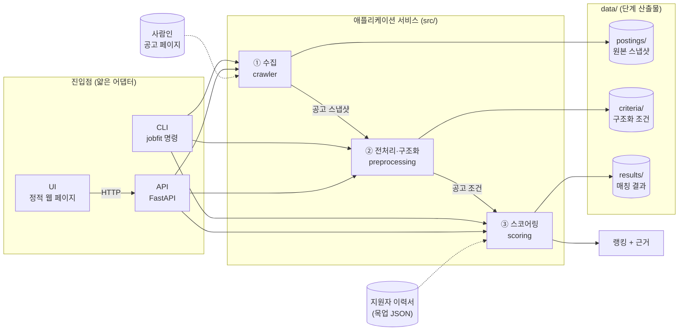
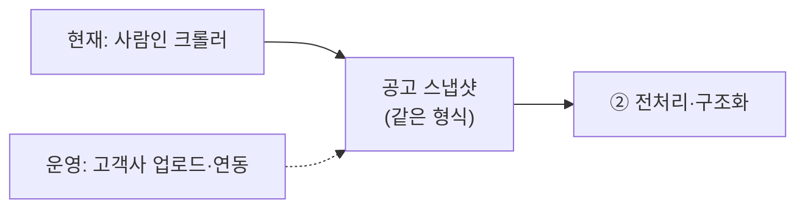

# 아키텍처

## 한눈에 보기



- **진입점 세 가지는 로직을 갖지 않는다.** CLI와 API는 같은 서비스 함수를 호출하고, UI는 API를 통해서만 서비스에 접근한다 ([ADR-0002](adr/0002-thin-entrypoints.md)).
- **단계 사이의 계약은 파일 산출물이다.** 각 단계는 앞 단계의 산출물만 읽는다. 전처리는 사람인을 모르고, 스코어링은 이미지를 모른다 ([ADR-0005](adr/0005-origin-snapshot.md)).
- **매칭 조건의 출처는 공고 이미지뿐이다.** 전처리는 스냅샷의 이미지만 입력으로 받고, 페이지 HTML의 텍스트(숨김 키워드, 제목 등)는 조건에 쓰지 않는다 ([ADR-0008](adr/0008-image-only-conditions.md)).

## 단계

| # | 단계 | 입력 | 출력 | 핵심 질문 | 상태 |
|---|---|---|---|---|---|
| ① | 수집 (crawler) | 사람인 공고 URL | 공고 원본 스냅샷 (HTML·이미지·매니페스트) | 이미지형 공고의 본문 이미지를 빠짐없이, 원본 그대로 확보하는가 | 스펙 01 완료 |
| ② | 전처리·구조화 (preprocessing) | 공고 스냅샷의 **이미지** | 구조화된 공고 조건 | 이미지에서 요건을 정확히 읽고, 직군과 무관한 구조로 표현하는가 | 스펙 02 완료 |
| ③ | 스코어링 (scoring) | 공고 조건 + 지원자 | 0~100 점수, 랭킹, 근거 | 점수가 납득 가능한 근거로 설명되는가 | 스펙 03 |

②, ③의 내부 설계는 해당 스펙에서 정한다. 이 문서는 단계 경계와 진입점 구조만 고정한다.

## 진입점

| 진입점 | 역할 | 도입 시점 |
|---|---|---|
| CLI | 개발·운영용 주 진입점. 단계별 명령 (`jobfit crawl`, …) | 스펙 01부터 단계마다 명령 추가 |
| API | UI와 외부 연동용. CLI와 같은 서비스 호출 | 보여줄 결과(③)가 생기는 시점 |
| UI | 결과와 근거 확인용 간단한 화면. API만 호출 | API와 함께 |

API·UI를 처음부터 만들지 않는 이유: ①·②만 있는 상태에서는 화면으로 보여줄 의미 있는 결과가 없고, 서비스 함수 시그니처가 단계 구현 중에 바뀔 수 있다. 서비스 계층이 어댑터와 분리되어 있으므로 나중에 붙이는 비용이 작다.

## 데이터 디렉터리

로컬 전용이며 버전 관리하지 않는다 ([ADR-0007](adr/0007-data-not-versioned.md)).

```
data/
  postings/{site}/{posting_id}/      ① 원본 스냅샷
    snapshot.json                       매니페스트 (출처, 수집 시각, 파일 해시, 이미지 메타)
    view.html  detail.html              원본 HTML
    images/00.jpg …                     원본 이미지 (바이트 그대로)
  criteria/{site}/{posting_id}/      ② 분할 조각, transcript.md, criteria.json (스펙 02)
  cache/llm/                         LLM 응답 캐시 (ADR-0014)
  results/{site}/{posting_id}/       ③ ranking.json (랭킹 + 요건별 판정·근거, 스펙 03)
```

## 운영 시 데이터 유입 (방향만)

채용 플랫폼을 서비스가 직접 크롤링해 적재하는 구조는 법적 리스크가 있다. 운영 구조에서는 공고가 **고객사를 거쳐** 들어오게 하고(업로드, 고객사 담당자 브라우저 확장, ATS 연동), 서비스는 그 입력으로 같은 형식의 스냅샷을 만든다. 그래서 스냅샷 매니페스트에는 수집 방법(`crawl` / `upload`)을 기록할 자리를 처음부터 둔다. 상세 설계는 별도 문서로 작성한다.


