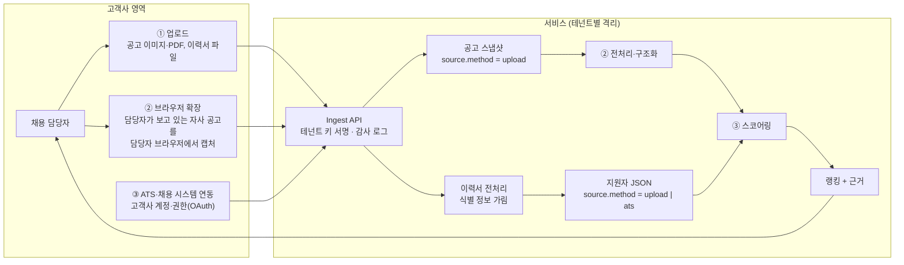

# 고객사 경유 데이터 유입 구조 (설계 — 미구현)

> 법률 자문이 아니다. 서비스 구조를 어떻게 잡을지에 대한 설계 방향이다.

## 1. 문제

지금의 수집기(스펙 01)는 서비스가 사람인 공고 페이지를 직접 요청해 원본을 저장한다. 데모로는 충분하지만, 운영에서 서비스 제공사가 채용 플랫폼의 공고를 직접 크롤링해 적재하면 다음 위험이 있다.

- **데이터베이스 권리**: 채용 플랫폼의 공고 모음은 저작권법상 데이터베이스로 보호될 수 있고, 상당 부분을 반복·체계적으로 복제하면 침해가 될 수 있다. 채용 플랫폼 사이의 공고 크롤링이 실제로 분쟁이 된 사례도 있다.
- **부정경쟁·약관**: 플랫폼이 투자로 만든 성과를 무단으로 쓰는 행위, 이용약관의 자동 수집 금지 조항.
- **개인정보**: 이력서는 개인정보다. 서비스가 직접 모으면 수집 근거·동의·보관 책임을 모두 서비스가 진다.

목표는 **데이터가 서비스가 아니라 고객사를 거쳐 들어오게** 해서, 데이터의 권리·수집 주체는 고객사가 되고 서비스는 고객사의 지시로 처리만 하는(수탁자) 구조로 만드는 것이다.

## 2. 원칙

1. **서비스 서버는 채용 플랫폼에 요청하지 않는다.** 공고를 보는 주체는 고객사(또는 그 담당자의 브라우저)다.
2. **고객사는 자기 데이터를 넣는다.** 기본 유스케이스는 고객사가 직접 작성한 **자사 공고**와 자사에 들어온 **지원서**다 — 권리 문제가 가장 작다.
3. **테넌트 격리.** 고객사마다 저장소를 나누고, 고객사 사이에 공고·이력서를 공유하거나 재사용하지 않는다. 서비스가 "공고 DB"를 쌓지 않는다.
4. **최소 보관.** 원본(이미지·이력서 파일)은 처리 후 정해진 기간이 지나면 지우고, 구조화 결과와 매칭 결과만 남긴다.
5. **추적 가능.** 누가, 언제, 어떤 경로로, 어떤 권한으로 올렸는지 감사 로그를 남긴다.

## 3. 구조

| 경로 | 무엇이 들어오나 | 누가 원본에 접근하나 | 비고 |
|---|---|---|---|
| ① 업로드 | 공고 이미지·PDF, 이력서 파일 | 고객사 담당자 | 가장 단순. 자사 공고 파일을 그대로 올린다 |
| ② 브라우저 확장 | 담당자 화면에 열린 자사 공고 페이지의 본문 이미지 | 담당자의 브라우저 (담당자 세션) | 서비스 서버는 플랫폼에 요청하지 않는다. 확장은 "현재 탭을 보내기" 버튼만 제공 — 자동 순회·대량 수집 없음 |
| ③ ATS 연동 | 자사 공고, 지원서·이력서 | 고객사 계정 권한 | 고객사가 이미 가진 데이터를 고객사 권한으로 가져온다 |

## 4. 지금 코드와의 연결

이 구조로 바꿀 때 **전처리·스코어링은 그대로** 쓴다. 단계 사이의 계약이 파일 산출물이기 때문이다 (ADR-0005).

| 지금 | 운영 구조 | 바뀌는 곳 |
|---|---|---|
| 수집기가 사람인에서 스냅샷 생성 (`source.method = "crawl"`) | Ingest API가 업로드·확장·ATS 입력으로 **같은 형식의 스냅샷** 생성 (`method = "upload"`) | 수집 단계만 교체. 스냅샷 매니페스트에 `method` 자리는 처음부터 있다 (ADR-0005) |
| 목업 지원자 JSON (`source.method = "mock"`) | 이력서 전처리가 파일·ATS 데이터로 **같은 형식의 지원자 JSON** 생성 (`method = "upload" / "ats"`) | 이력서 전처리 단계 추가 (설계: ADR-0016) |
| `data/` 한 곳 | `data/{tenant}/…` 테넌트별 디렉터리(또는 버킷), 테넌트 키로만 접근 | 경로에 테넌트 추가, API 인증 |
| LLM 응답 캐시 공용 | 테넌트별 캐시 (같은 이미지라도 테넌트 사이에 공유하지 않음) | 캐시 디렉터리에 테넌트 |
| 원본 무기한 보관 | 원본 TTL (예: 처리 후 30일), 구조화·결과만 보관 | 정리 작업 |

## 5. 개인정보 처리

- **식별 정보 가림**: 이름·연락처·주민번호·주소 상세는 판정에 쓰이지 않는다. LLM에 보내기 전에 가린다 (거주지는 시·구 수준만 — "인근 거주" 판정용).
- **민감 정보 미수집**: 장애·보훈 여부 등은 받지 않고, 법정 우대는 점수에 반영하지 않는다 (ADR-0018).
- **처리 위탁·국외 이전 고지**: 외부 LLM API로 이력서 텍스트가 전송되므로, 고객사가 지원자에게 받는 동의·고지에 처리 위탁(및 국외 이전)이 포함돼야 한다. 계약에 명시한다.
- **판정 로그**: 판정 결과에는 이력서 인용이 들어 있으므로 결과도 개인정보로 다룬다 (테넌트 격리·보관 기간 동일).

## 6. 책임 분담

| 항목 | 고객사 | 서비스 |
|---|---|---|
| 공고·이력서의 수집 권한과 적법성 | 보증 (약관·위수탁 계약) | 확인하지 않은 데이터는 받지 않음 (업로드 시 권한 확인 체크) |
| 지원자 동의·고지 | 받음 | 고지 문구 제공, 처리 범위 준수 |
| 저장·격리·삭제 | 보관 기간 지정 | 테넌트 격리, TTL 삭제, 감사 로그 |
| 판정·점수 | 최종 채용 결정 | 근거와 "확인 필요"를 함께 제공 — 점수만으로 자동 탈락시키지 않게 화면 구성 |

## 7. 트레이드오프

- **커버리지 감소**: 고객사가 올린 것만 처리한다. 시장 전체 공고를 모아 보여주는 기능은 만들 수 없다 — 의도한 제약이다.
- **도입 비용**: 업로드·확장·ATS 연동을 고객사별로 붙여야 한다. 브라우저 확장은 플랫폼 화면이 바뀌면 유지보수가 필요하다 (지금 수집기의 사이트 규칙과 같은 종류의 비용).
- **데모와의 차이**: 이 레포의 수집기는 평가용 공고 몇 건을 받는 데모다. 운영 구조에서는 수집 단계를 Ingest API로 바꾼다.
