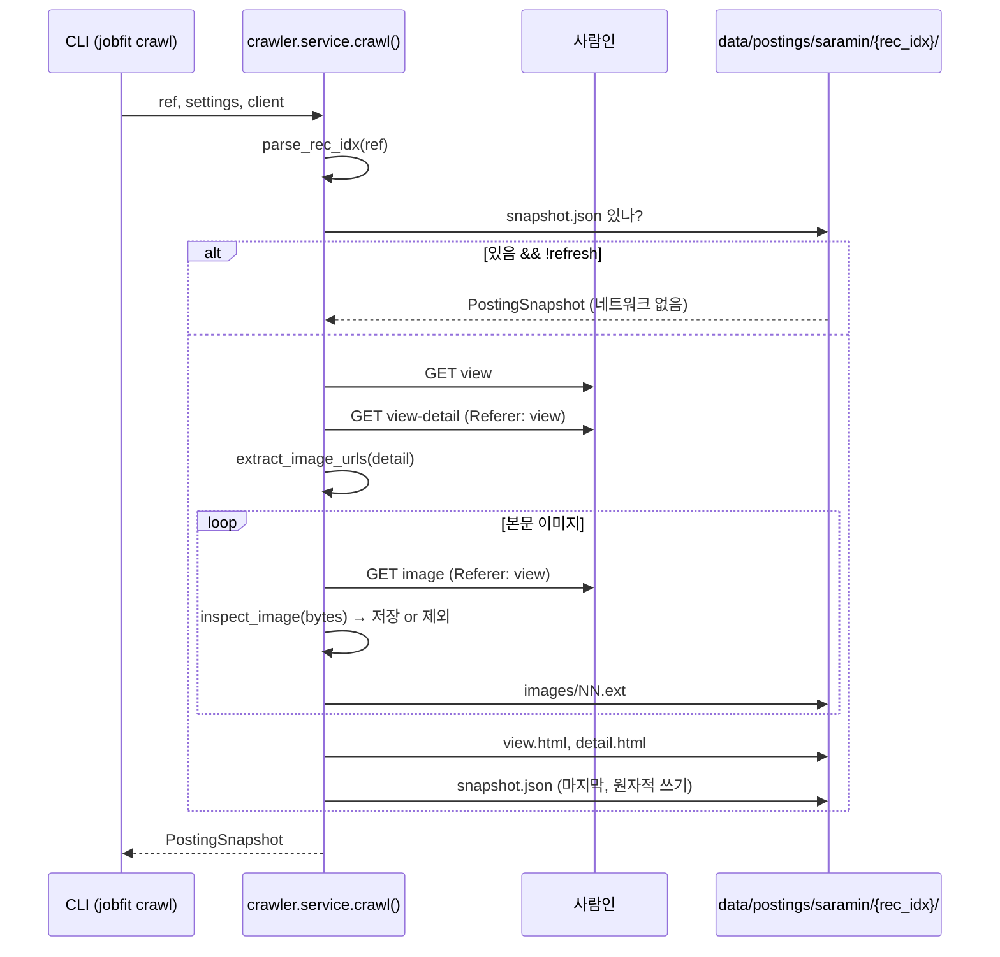

# 01. 공고 이미지 수집 (crawler) 설계

- 날짜: 2026-10-12
- 상태: 완료 (2026-10-12)
- 단계: ① 수집 ([architecture](../architecture.md))
- 구현 계획: [plans/2026-10-12-01-posting-crawler.md](../plans/2026-10-12-01-posting-crawler.md)
- 관련 ADR: [0001](../adr/0001-three-stage-delivery.md), [0002](../adr/0002-thin-entrypoints.md), [0003](../adr/0003-python-stack.md), [0004](../adr/0004-crawl-detail-iframe-over-http.md), [0005](../adr/0005-origin-snapshot.md)

## 1. 목표

사람인의 **이미지형 공고**를 공고 URL만으로 수집해, 이후 단계가 사람인 없이도 다시 쓸 수 있는 **원본 스냅샷**(원본 HTML, 본문 이미지 원본 바이트, 매니페스트)으로 저장한다.

이번 단계는 공고 내용을 읽거나 구조화하지 않는다. 산출물은 "이 공고의 본문 이미지는 이것들이고, 언제 어디서 받았다"까지다.

## 2. 요구사항

### 기능

| # | 요구사항 |
|---|---|
| F1 | 입력으로 사람인 공고 URL(여러 형태) 또는 숫자 rec_idx를 받는다 |
| F2 | 공식 Open API를 쓰지 않고, 공고 페이지(view)와 상세 iframe 문서(view-detail)를 HTTP로 받는다 |
| F3 | 상세 본문 영역에서 이미지 URL을 문서 순서대로 추출한다. 본문 밖 이미지, 로고·아이콘 경로, data URI, 중복은 제외한다 |
| F4 | 이미지를 내려받아 **디코딩 가능하고 긴 변이 200px 이상**인 것만 저장한다. 제외한 URL은 기록한다 |
| F5 | 원본 바이트를 그대로 저장하고, 파일마다 sha256·크기, 이미지마다 형식·가로·세로를 매니페스트에 기록한다 |
| F6 | 이미지형 공고인지 판별해 기록한다: 저장된 이미지 ≥ 1 **그리고** 화면에 보이는 본문 텍스트(공백 제외, 숨김 요소 제외) ≤ 300자. 아니면 경고만 하고 저장은 한다 |
| F7 | 매니페스트가 이미 있으면 네트워크 요청 없이 재사용한다. `--refresh`면 다시 수집해 교체한다 |
| F8 | CLI: `jobfit crawl <ref>...`(여러 건), `jobfit postings`(저장된 스냅샷 목록) |

### 비기능

| # | 요구사항 |
|---|---|
| N1 | 요청 간격 기본 1.5초, 브라우저 User-Agent, 공고 페이지를 Referer로 |
| N2 | 수집 도중 실패하면 매니페스트가 남지 않는다 (불완전한 스냅샷을 완전한 것으로 오인하지 않음) |
| N3 | 모든 테스트는 네트워크 없이 돈다 (`httpx.MockTransport`) |
| N4 | 사람인 HTML 구조에 대한 가정(경로·셀렉터)은 한 곳의 상수로 모은다 |

## 3. 설계

### 흐름



### 모듈

```
src/                       (ADR-0006: 패키지 네임스페이스 없이 src/ 바로 아래)
  settings.py              데이터 경로, User-Agent, 요청 간격 (환경변수)
  crawler/
    saramin.py             사람인 HTML 규칙 — 순수 함수 (네트워크 없음)
                             parse_rec_idx, extract_image_urls, body_text_length, extract_title
                             VIEW_URL, DETAIL_URL, CONTENT_SELECTORS  ← 사이트 가정은 여기만
    images.py              inspect_image(bytes) → ImageInfo | None, extension()
    snapshot.py            PostingSnapshot 모델, 파일 저장(sha256), 원자적 매니페스트 쓰기, 목록
    service.py             crawl(ref, settings, *, client, refresh, log) — 진입점들이 호출하는 서비스
  cli.py                   jobfit crawl / jobfit postings
```

사이트 규칙(`saramin.py`)과 저장 형식(`snapshot.py`)을 분리해, 다른 출처(고객사 업로드)가 생겨도 `snapshot.py`는 그대로 쓴다.

### 사람인에 대한 가정 (구현 계획 Task 9에서 검증)

| # | 가정 | 상수 |
|---|---|---|
| H1 | 상세 본문은 `/zf_user/jobs/relay/view-detail?rec_idx={id}&rec_seq=0` 문서에 있다 | `DETAIL_URL` |
| H2 | 본문 이미지는 `.user_content` 안의 ``다 (`src` 또는 `data-src`) | `CONTENT_SELECTORS` |
| H3 | 이미지는 Referer와 브라우저 UA만으로 받아진다 | — |
| H4 | 공고 페이지의 `og:title`(없으면 `<title>`)로 공고를 식별할 수 있다 | — |

`.user_content`가 없으면 문서 전체에서 찾는다(대체 경로). 가정이 틀리면 상수를 고치고 [ADR-0004](../adr/0004-crawl-detail-iframe-over-http.md)를 갱신한다.

## 4. 데이터 모델

공고 내용은 아직 구조화하지 않지만, **원본과 출처를 남기는 매니페스트**는 이 단계의 산출물이자 다음 단계의 입력 계약이다 ([ADR-0005](../adr/0005-origin-snapshot.md)).

```python
class SourceRef:
    site: str                      # "saramin"
    method: "crawl" | "upload"     # upload = 운영 시 고객사 경유 유입 (이번 단계는 crawl만)
    posting_id: str                # 사람인 rec_idx
    url: str                       # 사람이 보는 공고 페이지

class StoredFile:
    path: str                      # 스냅샷 디렉터리 기준 상대경로
    sha256: str
    bytes: int

class StoredImage(StoredFile):
    index: int                     # 본문 내 순서 (0부터, 제외된 이미지는 번호를 쓰지 않음)
    source_url: str
    format: str                    # "JPEG" | "PNG" | "GIF" | …
    width: int
    height: int

class PostingSnapshot:
    schema_version: int = 1
    source: SourceRef
    fetched_at: str                # ISO 8601 UTC
    title: str | None              # 식별용 페이지 메타데이터 — 매칭 조건으로 쓰지 않음
    view_html: StoredFile | None
    detail_html: StoredFile
    images: list[StoredImage]
    skipped_images: list[str]      # 받았지만 제외한 URL
    body_text_length: int
    is_image_posting: bool
```

예시 `data/postings/saramin/51234567/snapshot.json`:

```json
{
  "schema_version": 1,
  "source": {"site": "saramin", "method": "crawl", "posting_id": "51234567",
             "url": "https://www.saramin.co.kr/zf_user/jobs/relay/view?rec_idx=51234567"},
  "fetched_at": "2026-10-12T03:00:00+00:00",
  "title": "[OO산업] 회계팀 경력사원 채용",
  "view_html": {"path": "view.html", "sha256": "…", "bytes": 182311},
  "detail_html": {"path": "detail.html", "sha256": "…", "bytes": 4120},
  "images": [
    {"index": 0, "path": "images/00.jpg", "sha256": "…", "bytes": 512004,
     "source_url": "https://…/poster.jpg", "format": "JPEG", "width": 860, "height": 5120}
  ],
  "skipped_images": [],
  "body_text_length": 12,
  "is_image_posting": true
}
```

## 5. 인터페이스

```python
# crawler/saramin.py (순수 함수)
parse_rec_idx(ref: str) -> str                                  # ValueError
extract_image_urls(html: str, base_url: str = BASE) -> list[str]
body_text_length(html: str) -> int
extract_title(view_html: str) -> str | None

# crawler/images.py
inspect_image(data: bytes, *, min_long_side: int = 200) -> ImageInfo | None
extension(info: ImageInfo) -> str                               # ".jpg" | ".png" | …

# crawler/snapshot.py
snapshot_dir(data_dir, site, posting_id) -> Path
save_file(directory, rel_path, data) -> StoredFile
save_snapshot(directory, snapshot) -> Path                      # 원자적 쓰기
load_snapshot(directory) -> PostingSnapshot | None
list_snapshots(data_dir) -> list[PostingSnapshot]

# crawler/service.py
make_client(settings) -> httpx.Client
crawl(ref, settings, *, client, refresh=False, log=…) -> PostingSnapshot
```

```
$ jobfit crawl <URL|rec_idx> [<URL|rec_idx> …] [--refresh]
51234567  이미지 2장  이미지 공고  [OO산업] 회계팀 경력사원 채용

$ jobfit postings
┃ 사이트  ┃ ID       ┃ 이미지 ┃ 이미지 공고 ┃ 수집 시각            ┃ 제목 ┃
```

## 6. 오류 처리

| 상황 | 처리 |
|---|---|
| ref에서 rec_idx를 못 찾음 | `ValueError` |
| view·detail·이미지 요청 HTTP 4xx/5xx | `httpx.HTTPStatusError` 전파. 매니페스트 미생성 → 다음 실행에서 재수집 |
| 이미지가 아닌 응답(차단 페이지 등), 너무 작은 이미지 | 저장하지 않고 `skipped_images`에 기록 |
| 본문 이미지 0장 / 본문 텍스트가 김 | `is_image_posting: false`, CLI에서 경고. 스냅샷은 저장 |
| 다시 수집 (`--refresh` 또는 이전 시도 실패) | 본문 요청이 성공하면 기존 매니페스트와 `images/`를 먼저 지우고 새로 저장 — 이전 파일이 섞이지 않게. 도중 실패 시 스냅샷이 없는 상태가 되고 다음 실행에서 다시 수집 |

## 7. 테스트

| 테스트 | 고른 이유 |
|---|---|
| rec_idx 파싱: 숫자, URL 2종, 공백, 실패 | 진입점 입력이 다양함 |
| 이미지 URL 추출: 본문 밖 배너·로고·data URI·중복 제외, 상대경로, `data-src`, 본문 영역 없을 때 대체 | 수집 정확도의 핵심, HTML만으로 검증 가능 |
| 본문 텍스트 길이·제목 추출 | 이미지 공고 판별과 식별의 근거 |
| 이미지 검증: 정상 / 아이콘 크기 / 이미지 아닌 바이트, 확장자 | 차단 페이지를 이미지로 저장하는 사고 방지 |
| 스냅샷 저장·로드 왕복, 원자적 쓰기, 목록 | 단계 간 계약 형식 고정 |
| crawl (MockTransport): 요청 순서·Referer, 원본 바이트·해시, 제외 기록, 판별 | 서비스 전체를 오프라인으로 고정 |
| crawl: 재사용 시 네트워크 0회, `--refresh` 재수집, 이미지 실패 시 매니페스트 없음 | F7, N2 |
| CLI: crawl 여러 건 출력, postings 목록 | 어댑터가 서비스를 올바르게 호출 |
| 실제 사람인 상세 HTML fixture (있을 때) | H1·H2 회귀 |

## 8. 수용 기준

- [x] `pytest`가 네트워크 없이 통과
- [x] 서로 다른 직군의 실제 이미지형 공고 **2건**이 `jobfit crawl`로 수집되고 `is_image_posting: true` — S-OIL 사무직(55189170), 오리온 생산직(55162188)
- [x] 두 번째 `jobfit crawl`은 네트워크 요청 없이 재사용 (테스트로 검증)
- [x] 가정 H1–H4의 검증 결과가 9장에 기록됨
- [x] 9장에 다음 단계(전처리) 스펙을 쓰기 위한 관찰(이미지 크기·장수·형식)이 기록됨

## 9. 관찰 기록 (2026-10-12, 계획 Task 9–10)

### 수집한 공고와 선정 결과

| rec_idx | 공고 | 이미지 | 보이는 텍스트 (숨김) | 이미지 안 요건 | 결과 |
|---|---|---|---|---|---|
| **55189170** | S-OIL(주) 2026 사무직 신입사원 | 1장, 860×3170 PNG | 0자 (1,226자) | 학력·졸업시기, 공인어학성적, 병역, 해외여행 결격, 전공(직무별), 우대(영어 회화, 엔지니어 직무 자격증) | **공고 A로 선정** |
| **55162188** | (주)오리온 청주공장 생산직 | 1장, 720×1890 PNG | 0자 (숨김 블록 있음) | 업무(배합·성형·포장), 고졸 이상, 경력 무관, 야간근무 가능 / 우대: 인근거주, 해당직무 근무경험, 국가보훈대상 | **공고 B로 선정** |
| 54975614 | (주)신세계 2027 그룹 신입사원 | 1장, 860×1217 PNG | 0자 (1,632자) | 학력·졸업시기, 해외여행 결격 정도 | 제외 — 요건이 적고 A와 같은 사무 신입 |
| 55238467 | 근로복지공단 울산병원 2차 의료직 | 1장, 860×408 PNG | 0자 (숨김 블록 있음) | 없음 (안내 배너, 요강은 외부 링크·PDF) | 제외 — 이미지에 요건 없음 |
| 55240589 | 반도체 협력사 생산직 (수집 전 확인) | — | 텍스트 본문 | 경력·학력 무관 | 제외 — 텍스트 공고 |

선정 근거와 기준은 [ADR-0009](../adr/0009-evaluation-postings.md).

### 사이트 가정 검증 (H1–H4)

| 가정 | 결과 (수집 4건 모두 동일) |
|---|---|
| H1 iframe 경로 | ✅ `view-detail?rec_idx=…&rec_seq=0` 그대로 동작. 상수 변경 없음 |
| H2 본문 셀렉터 | ✅ `.user_content` 안에 `<table>` → `` 1개 |
| H3 이미지 수신 | ✅ `www.saraminimage.co.kr`, UA+Referer로 수신, 제외 0건 |
| H4 제목 | ✅ 단, `(D-2)`·`(오늘 마감)` 같은 상태와 ` - 사람인` 접미어가 붙는다 (표시용이므로 그대로 둠) |

### 발견 1: 숨김 키워드 블록

상세 본문 `.user_content` 안에 `font-size:0; height:0; overflow:hidden` 스타일의 `<td>`가 있고, 공고 제목과 사람인 직무 카테고리 경로("회계·세무·재무 > 직무·직업 > 재무" 등) 수십 줄이 들어 있다. 화면에는 보이지 않는 검색용 텍스트다. 이 때문에 처음에는 모든 이미지 공고가 "아님"으로 판별되었다.

- 조치: 본문 텍스트 길이에서 `display:none`, `visibility:hidden`, `font-size:0` 요소를 제외 (`HIDDEN_STYLE`). 실제 상세 HTML(55189170)을 `tests/fixtures/saramin_detail_real.html` 회귀 fixture로 추가.
- 이 숨김 텍스트는 사람인이 붙인 분류 정보이고 공고 본문이 아니므로 **매칭 조건으로 쓰지 않는다**. 조건은 이미지에서만 추출한다 ([ADR-0008](../adr/0008-image-only-conditions.md)).

### 발견 2: "이미지 공고"라도 이미지에 요건이 없을 수 있다

55238467은 본문이 이미지지만 안내 배너(공고명·접수기간·바로가기·SNS 버튼)뿐이고, 요강은 이미지맵 링크로 연결된 외부 채용 사이트와 PDF에 있다. 외부 링크·첨부를 따라가 수집하는 것은 범위 밖이다 (ADR-0008). 수집 단계의 판별은 "본문이 이미지"까지만 보장하고, "이미지 안에 요건이 있다"는 전처리에서 추출 결과로 판단해야 한다.

### 이미지 레이아웃 (선정 2건, 육안)

- **A — S-OIL (860×3170)**: 상단 1/3이 캐릭터 일러스트. 이어서 "모집분야" 표(분야 → 세부직무 → 전공 → 근무지, 병합 셀), "지원자격" 목록(들여쓴 보조 설명 포함), 전형절차 아이콘 흐름, 기타·고지 문단. 글씨가 작고 정보가 세로로 길게 이어진다.
- **B — 오리온 (720×1890)**: 상단 1/3이 일러스트. "모집 내용" 4열 표(모집분야 / 업무내용 및 자격요건 / 우대사항 / 근무지역) 안에 자격요건과 우대사항이 목록으로 들어 있다. 이어서 근무조건, 전형절차, 접수방법(제출서류), 복리후생, 유의사항.

### → 전처리 스펙(02)에 넘길 사항

1. **세로 길이·해상도**: A는 860×3170, B는 720×1890으로 폭도 다르다. 비전 모델 입력 해상도 제한에서 작은 글씨가 읽히는지 실험으로 확인하고, 세로 분할(슬라이싱)·확대 필요 여부를 정한다.
2. **표 구조**: 두 공고 모두 요건이 **표 안에** 있다 (A: 병합 셀 모집분야 표, B: 4열 모집 내용 표). 전사·구조화에서 행·열 관계(예: "세부직무 ↔ 전공", "자격요건 ↔ 우대사항" 열 구분)를 보존해야 한다.
3. **요건 구분**: B는 "자격요건"과 "우대사항"이 열로 나뉘어 있어 필수/우대 구분이 명확하다. A는 "지원자격" 목록 안에 "기타 우대사항" 하위 항목이 섞여 있다.
4. **요건 0개 감지**: 55238467 같은 안내 배너형은 추출 요건이 0개일 것 → 경고·부적합 표시가 필요하다.
5. **요건이 아닌 정보 구분**: 근무조건(근무형태·교대·근무지), 전형절차, 제출서류, 복리후생이 같은 이미지에 섞여 있다. 요건과 분리해야 한다.
6. **법정 우대 항목**: B의 "국가보훈대상자" 우대, 두 공고의 "보훈·장애인 관련법에 따른 우대"는 개인의 민감 속성에 해당한다. 추출은 하되 스코어링에서 어떻게 다룰지(점수 반영 여부)는 스펙 03에서 정한다.

## 10. 범위 밖

- 공고 내용 읽기·구조화 (스펙 02)
- API·UI (보여줄 결과가 생기는 단계에서, [ADR-0002](../adr/0002-thin-entrypoints.md))
- 검색 결과 페이지 크롤링, 공고 자동 선정
- 로그인·차단 우회, 헤드리스 브라우저
- 스냅샷 버전 이력, 고객사 업로드 경로 구현 (`method: upload`는 자리만)
