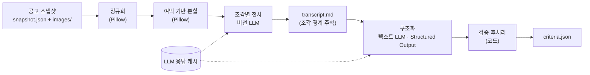
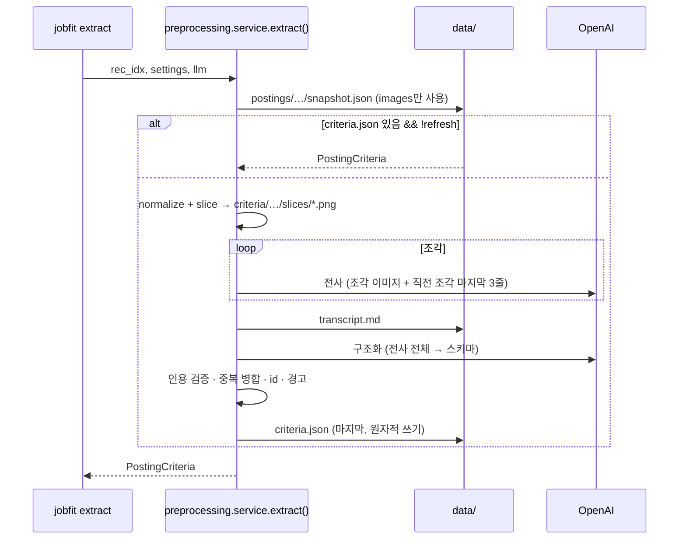

# 02. 공고 이미지 전처리·구조화 (preprocessing) 설계

- 날짜: 2026-10-12
- 상태: 검토 대기
- 단계: ② 전처리·구조화 ([architecture](../architecture.md))
- 입력: 스펙 01의 공고 스냅샷 — 평가용 A(S-OIL 55189170), B(오리온 55162188) ([ADR-0009](../adr/0009-evaluation-postings.md))
- 구현 계획: (스펙 승인 후 작성) `plans/2026-10-12-02-posting-preprocessing.md`
- 관련 ADR: [0008](../adr/0008-image-only-conditions.md), [0010](../adr/0010-vision-llm-extraction.md), [0011](../adr/0011-transcribe-then-structure.md), [0012](../adr/0012-whitespace-aware-slicing.md), [0013](../adr/0013-requirement-model.md), [0014](../adr/0014-llm-response-cache.md)

## 1. 목표

공고 스냅샷의 **이미지만**으로, 스코어링 단계가 바로 쓸 수 있는 **구조화된 공고 조건**(`PostingCriteria`)을 만든다. 사람이 중간에 손대지 않고, 추출한 값이 그대로 매칭 조건이 된다.

조건의 모든 항목은 **원본 이미지의 어느 부분에서 왔는지** 거슬러 올라갈 수 있어야 한다.

## 2. 배경 — 스펙 01에서 넘어온 것

| # | 관찰 (스펙 01 9장) | 이 스펙에서의 처리 |
|---|---|---|
| 1 | 이미지가 세로로 길다 (A 860×3170, B 720×1890), 폭도 다르다 | 4.4 이미지 전처리 — 정규화·분할 |
| 2 | 요건이 **표 안에** 있다 (A 병합 셀 모집분야 표, B 4열 모집 내용 표) | 전사 시 표를 마크다운 표로 보존, 구조화 시 열 의미 해석 |
| 3 | B는 "자격요건/우대사항"이 열로 나뉘고, A는 "지원자격" 목록 안에 "기타 우대사항"이 섞여 있다 | 필수/우대 판별 규칙을 구조화 프롬프트에 명시 |
| 4 | 안내 배너형 공고는 이미지에 요건이 없다 | 요건 0개 → `suitable: false` + 경고 |
| 5 | 근무조건·전형절차·제출서류·복리후생이 같은 이미지에 섞여 있다 | 요건과 분리. 근무조건은 `conditions`로, 나머지는 버린다 |
| 6 | 국가보훈·장애인 우대 같은 **법정 우대** 항목 | 추출하되 `sensitive: true` 표시. 점수 반영 여부는 스펙 03 |

## 3. 요구사항

### 기능

| # | 요구사항 |
|---|---|
| F1 | 입력은 공고 스냅샷의 `images` 목록뿐이다. HTML(`view.html`, `detail.html`)은 읽지 않는다 ([ADR-0008](../adr/0008-image-only-conditions.md)) |
| F2 | 이미지를 정규화한다: RGB 변환, **투명 배경은 흰색으로 합성**, 애니메이션은 첫 프레임 |
| F3 | 세로로 긴 이미지는 모델이 읽을 수 있는 크기로 분할한다. 분할선은 **글자 줄 사이 여백**에서 고른다 ([ADR-0012](../adr/0012-whitespace-aware-slicing.md)) |
| F4 | 조각마다 비전 LLM으로 **원문 전사**(요약·해석 없이)를 받는다. 표는 마크다운 표로 |
| F5 | 전사 전체를 한 번에 텍스트 LLM으로 **구조화**한다 (Structured Output) |
| F6 | 요건마다 근거 인용(`evidence.quote`)과 출처 위치(이미지·조각 번호)를 남긴다 |
| F7 | 코드로 검증한다: 근거 인용이 전사에 실제로 있는가, 중복 요건 병합, id 부여, 이상 경고 |
| F8 | 요건이 0개면 `suitable: false`와 경고 (안내 배너형 공고) |
| F9 | 근무조건(고용형태·근무지·근무시간·교대)은 요건과 분리해 `conditions`에 둔다. 전형절차·제출서류·복리후생은 저장하지 않는다 |
| F10 | 법정 우대(국가보훈·장애인 등) 요건에 `sensitive: true` 표시 |
| F11 | CLI: `jobfit extract <rec_idx|URL>...` (`--refresh`), `jobfit criteria <rec_idx>` (추출 결과 표) |

### 비기능

| # | 요구사항 |
|---|---|
| N1 | 같은 입력(이미지 바이트·프롬프트·모델)이면 LLM을 다시 호출하지 않는다 — 응답 캐시 ([ADR-0014](../adr/0014-llm-response-cache.md)) |
| N2 | 모델명·분할 파라미터는 설정으로 바꾼다 (코드 수정 없이 실험) |
| N3 | 단위 테스트는 LLM·네트워크 없이 돈다 (LLM 대역) |
| N4 | 비용: 공고 2건 전체 처리가 예산 대비 무시할 수준 (목표 $0.10 이하/회) |
| N5 | 중간 산출물(분할 이미지, 전사 텍스트)을 파일로 남겨 사람이 원본과 대조할 수 있다 |

## 4. 접근 방식 — 이미지에서 요건을 어떻게 뽑을 것인가

이 단계의 핵심 결정이다. 문제는 두 부분으로 나뉜다.

1. **읽기**: 이미지 → 글자 (OCR)
2. **이해**: 글자 → 구조 (어느 줄이 필수 요건이고, 어느 유형이며, 어느 모집분야에 해당하는가)

### 4.1 후보

| | 방식 | 읽기 | 이해 |
|---|---|---|---|
| A | **이미지 분석만** | OCR 엔진 (Tesseract / PaddleOCR / EasyOCR) | 규칙 (섹션 제목 정규식, 키워드 사전) |
| B | **OCR + LLM** | OCR 엔진 | 텍스트 LLM |
| C | **비전 LLM 2단계** | 비전 LLM으로 원문 전사 | 텍스트 LLM으로 구조화 + 코드 검증 |
| D | **비전 LLM 1단계** | 비전 LLM이 이미지에서 바로 구조화 JSON | (같은 호출) |
| E | **하이브리드** | 비전 LLM 전사 + OCR 교차 검증 | 텍스트 LLM |

### 4.2 비교

| 기준 | A 이미지 분석만 | B OCR+LLM | C 비전 LLM 2단계 | D 비전 LLM 1단계 | E 하이브리드 |
|---|---|---|---|---|---|
| 디자인된 한글 포스터 인식 | 낮음 — 장식 폰트·컬러 배경·작은 글씨에 약함 | 낮음 (A와 같은 OCR) | 높음 | 높음 | 높음 |
| 표 구조 보존 (병합 셀) | 거의 불가 — 글자 위치만 나옴, 별도 표 인식 필요 | 불가 (LLM이 받는 텍스트에 이미 구조가 없음) | 가능 — 마크다운 표로 전사 | 가능 | 가능 |
| 직군·레이아웃 일반화 | **낮음** — 섹션 제목·키워드 규칙이 공고마다 다름 ("지원자격", "자격요건", 표의 열 제목) | 중간 | 높음 | 높음 | 높음 |
| 근거 추적 (어느 줄에서 왔나) | 높음 (좌표까지) | 중간 | **높음** — 전사 텍스트 줄을 인용, 코드로 존재 검증 | 낮음 — 중간 텍스트가 없어 인용 검증 불가 | 높음 |
| 오류 원인 구분 | 쉬움 | 중간 | **쉬움** — "읽기 오류 vs 해석 오류"를 전사 파일로 구분 | 어려움 | 쉬움 |
| 환각 위험 | 없음 | 낮음 | 중간 → 인용 검증으로 완화 | 높음 | 낮음 |
| 결정성·재현성 | 높음 | 중간 | 중간 → 응답 캐시로 완화 | 중간 | 중간 |
| 비용 | 0 | 낮음 | 낮음 (조각 수 × 비전 호출 + 1회 구조화) | 가장 낮음 | 중간 |
| 설치 부담 | 중~높음 (Tesseract 언어팩 / Paddle 모델) | 중~높음 | 낮음 (API 키) | 낮음 | 높음 |
| 구현 복잡도 | 높음 (규칙 유지보수) | 중간 | 중간 | 낮음 | 높음 |

### 4.3 결정: C — 비전 LLM으로 전사, 텍스트 LLM으로 구조화, 코드로 검증

- **A(이미지 분석만)를 택하지 않는 이유**: 읽기 품질 이전에 **이해**에서 막힌다. 공고마다 섹션 이름과 레이아웃이 다르다(A는 "지원자격" 목록, B는 "업무내용 및 자격요건/우대사항" 표의 열). 규칙으로 이를 다루면 공고·직군이 늘 때마다 규칙을 추가해야 하고, 이는 "직군 무관 일반화"와 정면으로 충돌한다.
- **B(OCR+LLM)를 택하지 않는 이유**: 이해는 LLM이 맡지만, OCR 단계에서 표 구조와 작은 글씨가 이미 손실된다. 손실된 정보는 뒤 단계에서 복구할 수 없다.
- **D(1단계)를 택하지 않는 이유**: 호출은 줄지만 중간 텍스트가 없어서, 요건이 틀렸을 때 원인을 구분할 수 없고 근거 인용을 검증할 대상이 없다.
- **E(하이브리드)를 지금 택하지 않는 이유**: 교차 검증의 이득에 비해 OCR 설치·정렬 비용이 크다. C의 인용 검증으로 환각을 먼저 막고, 실험(4.5)에서 읽기 오류가 많으면 그때 도입한다.

상세 근거: [ADR-0010](../adr/0010-vision-llm-extraction.md), [ADR-0011](../adr/0011-transcribe-then-structure.md)

### 4.4 그래도 "단순 이미지 분석"이 맡는 일 — 전처리

LLM에 넣기 전, 이미지 자체를 다루는 일은 결정적인 코드(Pillow)로 한다. LLM에 맡길 이유가 없고, 테스트할 수 있다.

| 작업 | 방법 | 이유 |
|---|---|---|
| 정규화 | RGB 변환, 투명 → 흰 배경 합성, GIF 첫 프레임 | 투명 PNG를 그냥 RGB로 바꾸면 배경이 검정이 되어 검은 글자가 사라진다 |
| 폭 맞춤 | 폭이 `max_width`보다 크면 비율 유지 축소 | 모델 입력 규격 안에서 글자 크기 유지 |
| **여백 기반 분할** | 행(row)별 픽셀 분산으로 "잉크가 없는 행"을 찾고, 목표 높이 근처의 가장 긴 여백 띠에서 자른다. 여백이 없으면 고정 높이 + 겹침으로 자른다 | 고정 높이로 자르면 글자 줄·표 행이 반으로 잘려 양쪽에서 오독된다. 포스터는 섹션 사이 여백이 넓어서 대부분 깔끔하게 자를 수 있다 |
| 빈 조각 제거 | 조각 전체 분산이 임계값 이하면 버린다 | 여백만 있는 조각에 비용을 쓰지 않는다 |

분할이 필요한 이유: 비전 모델은 큰 이미지를 내부 규격으로 **축소**한다. 예를 들어 OpenAI의 `high` 상세도는 모델에 따라 "2048×2048 안에 맞춤"과 같은 축소를 하므로, 860×3170 이미지는 폭이 약 556px로 줄어 작은 글씨가 뭉개질 수 있다 ([OpenAI Images & vision 가이드](https://developers.openai.com/api/docs/guides/images-vision/index.html)). 다만 모델·상세도 옵션(`original` 등)에 따라 축소 규칙이 다르므로, **분할이 실제로 필요한지는 4.5 실험으로 정한다.**

상세: [ADR-0012](../adr/0012-whitespace-aware-slicing.md)

### 4.5 결정을 확인하는 실험

공고 A·B에 대해 사람이 이미지를 보고 만든 **정답 요건 목록**(`tests/fixtures/criteria_truth/{rec_idx}.yaml`)을 두고 비교한다.

| 실험 | 비교 대상 | 지표 | 판단 |
|---|---|---|---|
| X1 분할 필요성 | 통째 입력 vs 여백 분할 (조각 높이 800 / 1200) | 정답 요건 줄의 전사 재현율, 숫자·고유명사 오독 수 | 재현율이 같으면 통째(호출 적음), 다르면 높은 쪽 |
| X2 모델 | 사용 가능한 비전 모델 2종 (상위/경량) | X1 지표 + 비용 | 재현율 차이가 없으면 경량 |
| X3 구조화 품질 | 최종 `PostingCriteria` vs 정답 | 요건 재현율·정밀도, 필수/우대 일치율, 유형 일치율 | 수용 기준(10장) 충족 여부 |
| X4 (선택) OCR 기준선 | Tesseract `kor` 전사 vs 비전 LLM 전사 | X1 지표 | 결정 C의 근거를 수치로 남김. 설치가 가능할 때만 |

정답 목록은 **평가 전용**이다. 파이프라인은 정답을 읽지 않는다.

## 5. 설계

### 흐름





### 모듈

```
src/
  llm.py                    LLM 프로토콜 + OpenAI 구현 + 응답 캐시 (스코어링 단계도 사용)
  preprocessing/
    images.py               normalize(), find_cut_rows(), slice_image() — 순수 이미지 처리
    prompts.py              전사·구조화 프롬프트
    transcribe.py           transcribe(llm, slices) → 전사 텍스트
    structure.py            structure(llm, transcript) → LLM 출력 스키마 → PostingCriteria
    verify.py               quote 검증, 중복 병합, id 부여, 경고, suitable 판정
    criteria.py             PostingCriteria 모델, 저장/로드
    service.py              extract(ref, settings, llm, refresh) — CLI·API 공용
  cli.py                    + jobfit extract / jobfit criteria
```

### 전사 규칙 (프롬프트 요지)

- 보이는 글자를 **그대로**. 요약·해석·보정·번역 금지
- 읽기 순서: 위→아래, 왼쪽→오른쪽. 다단 레이아웃은 단 순서대로
- 표는 마크다운 표. 병합 셀은 값을 반복해서 채운다 (행마다 완결된 정보가 되게)
- 섹션 제목은 `## `
- 직전 조각의 마지막 줄들이 주어지면, 겹치는 줄은 다시 쓰지 않는다
- 글자가 없으면 빈 문자열

### 구조화 규칙 (프롬프트 요지)

- 요건은 **하나의 판정 가능한 조건** 단위로 나눈다 ("A 및 B" → 2개)
- `priority`: 자격요건·지원자격·필수 → `must` / 우대·우대사항 → `preferred`. 목록 안 "우대" 하위 항목도 `preferred`
- `category` 8종 ([ADR-0013](../adr/0013-requirement-model.md))
- 모집분야가 여럿이면 `positions`로 나열하고, 특정 분야에만 해당하는 요건(예: "엔지니어 직무: 관련 자격증 우대", 분야별 전공)은 `positions`로 범위를 표시한다
- 근무조건 → `conditions`, 전형절차·제출서류·복리후생 → 버림
- 법정 우대(국가보훈·장애인 등) → `sensitive: true`
- 근거: 전사 텍스트의 해당 줄을 **그대로** `evidence.quote`에
- 전사에 없는 내용은 만들지 않는다

### 검증·후처리 (코드)

| 단계 | 규칙 |
|---|---|
| 인용 검증 | `evidence.quote`를 공백 무시하고 전사에서 찾는다. 없으면 `flags: ["quote_not_found"]` (요건은 유지, 사람이 확인) |
| 출처 위치 | 인용을 찾은 위치의 조각 경계 주석으로 `image_index`, `slice_index`를 채운다 |
| 중복 병합 | 같은 category에서 공백만 다른 요건은 하나로. 하나라도 `must`면 `must` (겹침 분할로 같은 줄이 두 번 전사될 수 있음) |
| id | `r1, r2, …` 코드가 순서대로 부여 (LLM이 정하지 않음) |
| 경고 | 요건 0개 / 필수 0개 / 30개 초과 / `quote_not_found` 존재 |
| suitable | 요건 ≥ 1 |

## 6. 데이터 모델 — `PostingCriteria`

```python
class EvidenceRef:
    quote: str                     # 전사 텍스트에서 그대로 인용
    image_index: int | None        # 코드가 채움
    slice_index: int | None

class Requirement:
    id: str                        # "r1"… 코드가 부여
    text: str                      # 공고 문구 (전사 그대로에 가깝게)
    normalized: str                # 짧은 라벨 (매칭·표시용)
    priority: "must" | "preferred"
    category: "experience" | "education" | "certification" | "language"
              | "skill" | "domain_knowledge" | "soft_skill" | "other"
    positions: list[str]           # 비어 있으면 모든 모집분야에 적용
    min_years: float | None        # experience
    min_education: "none"|"high_school"|"associate"|"bachelor"|"master"|"phd" | None   # education
    sensitive: bool                # 법정 우대 등 민감 속성
    evidence: EvidenceRef
    flags: list[str]

class Position:
    name: str                      # "재무", "공정", "생산직"
    group: str | None              # "사무직(본사)" 등 상위 분류
    duties: str | None             # 세부 직무
    location: str | None

class Conditions:                  # 점수에 쓰지 않는 참고 정보
    employment_type: str | None
    locations: list[str]
    schedule: str | None           # 근무 요일·시간·교대
    others: list[str]

class PostingCriteria:
    schema_version: int = 1
    source: { site, posting_id, snapshot_fetched_at, image_sha256: list[str] }   # 어떤 스냅샷에서 왔나
    extracted_at: str
    models: { transcribe: str, structure: str }
    title: str                     # 이미지에서 읽은 공고명
    company: str | None
    job_family: str                # 자유 텍스트 (enum 아님)
    positions: list[Position]
    requirements: list[Requirement]
    conditions: Conditions
    suitable: bool
    warnings: list[str]
```

예시 (공고 B, 일부):

```json
{
  "schema_version": 1,
  "source": {"site": "saramin", "posting_id": "55162188",
             "snapshot_fetched_at": "2026-10-12T03:53:38+00:00", "image_sha256": ["1367c62c…"]},
  "models": {"transcribe": "<vision model>", "structure": "<text model>"},
  "title": "㈜오리온 청주공장 생산직 채용",
  "company": "㈜오리온",
  "job_family": "식품 생산",
  "positions": [{"name": "생산직", "group": null, "duties": "제품 생산 (배합/성형/포장)", "location": "청주"}],
  "requirements": [
    {"id": "r1", "text": "고등학교 졸업 이상", "normalized": "고졸 이상", "priority": "must",
     "category": "education", "positions": [], "min_years": null, "min_education": "high_school",
     "sensitive": false, "evidence": {"quote": "고등학교 졸업 이상", "image_index": 0, "slice_index": 1}, "flags": []},
    {"id": "r2", "text": "야간근무 가능", "normalized": "야간근무", "priority": "must", "category": "other", "…": "…"},
    {"id": "r3", "text": "인근거주자", "normalized": "인근 거주", "priority": "preferred", "category": "other", "…": "…"},
    {"id": "r4", "text": "해당직무 근무경험자", "normalized": "생산직 경험", "priority": "preferred", "category": "experience", "…": "…"},
    {"id": "r5", "text": "국가보훈대상자", "normalized": "국가보훈", "priority": "preferred", "category": "other",
     "sensitive": true, "…": "…"}
  ],
  "conditions": {"employment_type": "정규직(수습기간 3개월)", "locations": ["충북 청주시 흥덕구 …"],
                 "schedule": "주 5일(월~금), 생산계획에 따라 근무시간/야간근무 변동", "others": []},
  "suitable": true,
  "warnings": []
}
```

"경력 무관"은 요건이 아니다 (조건이 없음을 뜻함) → 요건으로 만들지 않는다.

### 저장 위치

```
data/criteria/{site}/{posting_id}/
  slices/00_00.png …       분할 조각 (이미지 index_조각 index)
  transcript.md            전사 전체 (조각 경계 주석 포함)
  criteria.json            결과 (마지막, 원자적 쓰기)
data/cache/llm/            LLM 응답 캐시 (ADR-0014)
```

## 7. 인터페이스

```python
# preprocessing/images.py (순수 함수)
normalize(img: Image) -> Image
find_cut_rows(img, *, target_height, search_window, ink_threshold) -> list[int]
slice_image(img, *, max_width, target_height, overlap, ...) -> list[Image]

# llm.py
class LLM(Protocol):
    def vision_text(self, *, model, system, image: Path, user_text: str | None) -> str
    def structured(self, *, model, system, user, schema: type[T]) -> T
class OpenAILLM: ...            # 실제 호출
class CachedLLM: ...            # 다른 LLM을 감싸 디스크 캐시 (ADR-0014)

# preprocessing/service.py
extract(ref, settings, *, llm, refresh=False, log=…) -> PostingCriteria
```

```
$ jobfit extract 55162188 55189170 [--refresh]      # 출력 형식 예시 (수치는 실행 결과에 따라 다름)
55162188  요건 N개 (필수 n, 우대 m)  모집분야 k  ⚠ 0   ㈜오리온 청주공장 생산직 채용
55189170  요건 N개 (필수 n, 우대 m)  모집분야 k  ⚠ 0   2026 S-OIL 사무직 신입사원 채용

$ jobfit criteria 55162188
┃ id ┃ 구분 ┃ 유형      ┃ 요건              ┃ 모집분야 ┃ 근거                ┃
│ r1 │ 필수 │ education │ 고등학교 졸업 이상 │ 전체     │ img0/slice1 ✓      │
```

설정 (환경변수):

| 변수 | 기본값 | 설명 |
|---|---|---|
| `OPENAI_API_KEY` | — | 필수 (캐시에 없는 호출 시) |
| `JOBFIT_VISION_MODEL` | 실험 X2로 결정 | 전사 모델 |
| `JOBFIT_TEXT_MODEL` | 실험 X2로 결정 | 구조화 모델 |
| `JOBFIT_SLICE_HEIGHT` | 실험 X1로 결정 (`0` = 분할 안 함) | 조각 목표 높이 |

## 8. 오류 처리

| 상황 | 처리 |
|---|---|
| 스냅샷 없음 | `RuntimeError("먼저 jobfit crawl …")` |
| 스냅샷 이미지 0장 | `suitable: false`, 경고. LLM 호출 없음 |
| API 키 없음 + 캐시 미스 | `RuntimeError` (키 설정 안내) |
| LLM 오류·타임아웃 | 예외 전파. 이미 끝난 조각은 캐시에 남아 재실행 시 이어서 진행 |
| 구조화 응답 거부·스키마 불일치 | `RuntimeError` (거부 사유 포함) |
| 인용이 전사에 없음 | 요건 유지 + `quote_not_found` 플래그 + 경고 |
| 요건 0개 | `suitable: false` + 경고 |

## 9. 테스트

| 테스트 | 고른 이유 |
|---|---|
| 정규화: 투명 PNG → 흰 배경, GIF 첫 프레임 | 실제로 글자가 사라지는 버그를 막는다 |
| 분할: 여백 행에서 자름, 여백 없으면 고정 높이+겹침, 짧은 이미지는 그대로, 빈 조각 제거 | 줄이 잘리지 않는다는 핵심 성질 |
| 전사 조립 (LLM 대역): 조각 경계 주석, 직전 꼬리 3줄 전달 | 출처 위치 추적의 기반 |
| 구조화 후처리: id 순서, 중복 병합(must 우선), 인용 검증 플래그, 출처 위치 채움, 경고, suitable | 코드가 책임지는 부분 전부 |
| **HTML을 읽지 않는다**: 스냅샷에서 `view.html`·`detail.html`을 지워도 `extract`가 같은 결과 | ADR-0008을 코드로 강제 |
| 캐시: 같은 입력 두 번째 호출은 API 미호출, 다른 모델·이미지는 다른 키 | N1 |
| 서비스 (LLM 대역): 재사용, `--refresh`, 실패 시 criteria.json 없음 | 수집 단계와 같은 원자성 |
| CLI: extract 출력, criteria 표 | 어댑터 |
| 평가 스크립트 (수동, API 사용): 정답 대비 재현율·정밀도 | LLM 품질은 단위 테스트가 아니라 실험으로 본다 |

## 10. 수용 기준

- [ ] `pytest`가 네트워크·API 키 없이 통과
- [ ] `jobfit extract 55189170 55162188`가 두 공고 모두 `suitable: true`
- [ ] 정답 대비 **필수 요건 재현율 100%**, 전체 요건 재현율 ≥ 90%, 정밀도 ≥ 90% (실험 X3)
- [ ] 필수/우대 구분 일치율 100%
- [ ] `quote_not_found` 0건 (있으면 원인 기록)
- [ ] 실험 X1·X2 결과가 11장에 기록되고, 분할 높이·모델 기본값이 정해짐 (ADR-0010/0012 갱신)
- [ ] 2회 연속 실행 시 두 번째는 API 호출 0회 (캐시)

## 11. 관찰 기록 (구현 후 작성)

| 실험 | 설정 | 공고 A 결과 | 공고 B 결과 | 결론 |
|---|---|---|---|---|
| X1 | | | | |
| X2 | | | | |
| X3 | | | | |
| X4 | | | | |

## 12. 범위 밖

- 지원자 이력서 처리, 점수 (스펙 03)
- 법정 우대 항목의 점수 반영 방식 (스펙 03)
- 외부 링크·PDF 첨부 따라가기 (ADR-0008)
- 사람이 추출 결과를 편집하는 UI
- 텍스트 공고(본문이 HTML 텍스트) 처리
