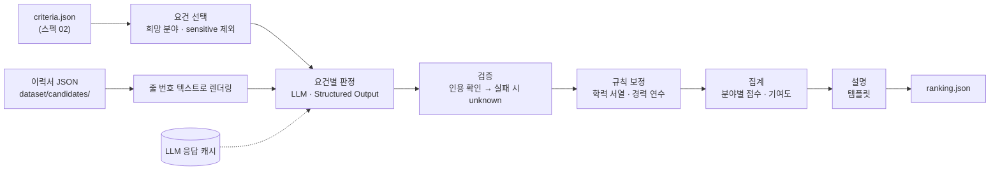
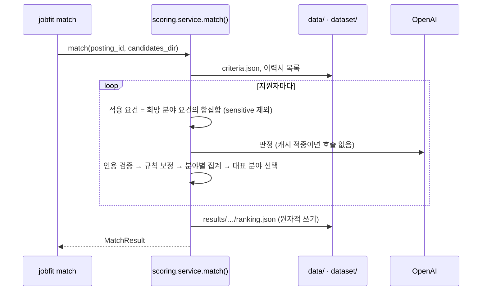

# 03. 지원자 매칭 스코어링 (scoring) 설계

- 날짜: 2026-10-12
- 상태: 승인 · 구현 완료 (실험 대기)
- 단계: ③ 스코어링 ([architecture](../architecture.md))
- 입력: 스펙 02의 `PostingCriteria` (평가용 A S-OIL 55189170, B 오리온 55162188), 목업 이력서 12건
- 구현 계획: [plans/2026-10-12-03-candidate-scoring.md](../plans/2026-10-12-03-candidate-scoring.md)
- 관련 ADR: [0008](../adr/0008-image-only-conditions.md), [0013](../adr/0013-requirement-model.md), [0014](../adr/0014-llm-response-cache.md), [0015](../adr/0015-judge-then-aggregate.md), [0016](../adr/0016-candidate-model-and-mock-dataset.md), [0017](../adr/0017-score-formula.md), [0018](../adr/0018-statutory-preferences-not-scored.md)

## 1. 목표

공고 이미지에서 뽑은 요건(`PostingCriteria.requirements`)을 **그대로 매칭 조건으로** 써서, 지원자마다

1. 0~100점 점수와 랭킹을 매기고,
2. 점수가 **요건별 판정 → 기여 점수**로 분해되어, 사람이 "왜 이 점수인가"를 이력서의 근거 줄까지 따라갈 수 있게 한다.

새 직군의 공고가 와도 코드를 고치지 않는다. 직군 지식은 요건 데이터(스펙 02)와 판정 LLM에 있고, 코드는 유형(category)과 판정 상태만 안다.

## 2. 배경 — 스펙 02에서 넘어온 것

| # | 관찰 (스펙 02 11장) | 이 스펙에서의 처리 |
|---|---|---|
| 1 | 요건은 `must`/`preferred` × 8개 유형, 모집분야 범위(`positions`)를 가진다 | 지원자의 희망 분야에 해당하는 요건만 평가 (5.3) |
| 2 | A는 모집분야 9개, 분야마다 전공 조건이 다르다. B는 1개 | 희망 분야별로 점수를 내고 가장 높은 분야를 대표 점수로 (5.3) |
| 3 | 법정 우대(국가보훈·장애인)가 `sensitive: true`로 표시돼 있다 | 점수에 반영하지 않고, 이력서에도 받지 않는다 (ADR-0018) |
| 4 | "남성의 경우 병역필", "해외여행 결격사유 없음", "2027년 1월 입사 가능"처럼 **이력서로 확인하기 어려운 자격**이 필수에 있다 | 판정 상태에 `unknown`(확인 필요)과 `not_applicable`(해당 없음)을 둔다 (5.4) |
| 5 | "영어권 해외대학 졸업자는 공인영어성적 제출 면제" 같은 예외 조항은 요건이 되지 않았다 | 판정 LLM에는 요건 문구(`text`)만 준다 (전사 원문을 다시 읽히지 않음). 요건 문구 **안의** 단서·기한은 판정하지만, 요건 밖의 예외 조항은 다루지 않는다. 이번 데이터셋에는 해당 지원자를 넣지 않는다 (12장) |
| 6 | 공고 A의 요건은 대부분 직무와 무관한 공통 자격이다 (학력·영어·병역) | 요건에 없는 "직무 적합도"를 만들어 넣지 않는다 (ADR-0008) — 관찰로 기록 (교차 평가, 4.6) |

## 3. 요구사항

### 기능

| # | 요구사항 |
|---|---|
| F1 | 입력은 `criteria.json`과 지원자 이력서 JSON 목록이다. 공고 이미지·전사·HTML은 읽지 않는다 |
| F2 | 지원자 × 요건마다 판정 상태(`met` / `partial` / `unmet` / `unknown` / `not_applicable`)와 **이력서 근거 인용**, 한 줄 사유를 만든다 |
| F3 | 근거 인용이 이력서에 실제로 있는지 코드로 확인한다. 없으면 판정을 `unknown`으로 내리고 표시한다 |
| F4 | 학력 수준(`min_education`)과 경력 연수(`min_years`)는 **코드가 계산**한다. LLM은 어느 경력이 관련 있는지만 고른다 |
| F5 | 점수는 판정에서 **코드가** 계산한다 (LLM이 숫자를 내지 않는다). 요건별 기여 점수의 합이 최종 점수와 같다 |
| F6 | 지원자의 희망 모집분야에 해당하는 요건만 평가한다. 희망 분야가 없으면 모든 분야를 평가하고 가장 높은 분야를 쓴다 |
| F7 | `sensitive` 요건은 점수에서 제외하고 결과에 "법정 우대 — 점수 미반영"으로 표시한다 |
| F8 | 설명은 템플릿으로 만든다: 필수 충족 수, 미충족 요건, 확인 필요 요건, 우대 충족 수 |
| F9 | 결과(랭킹 + 요건별 근거)를 `data/results/{site}/{posting_id}/ranking.json`에 저장한다 |
| F10 | CLI: `jobfit match <rec_idx>...` (`--candidates`, `--refresh`), `jobfit result <rec_idx> [--candidate ID]` |
| F11 | 목업 이력서 12건(공고당 완벽 2 · 부분 3 · 미스매치 1)을 레포에 포함한다. 목업은 이력서 전처리 결과(`Candidate` JSON)로 본다. 의도 라벨은 평가 전용이며 스코어링은 읽지 않는다 |

### 비기능

| # | 요구사항 |
|---|---|
| N1 | 판정은 지원자 × 공고당 LLM 1회. 같은 입력이면 캐시로 재호출하지 않는다 (ADR-0014) |
| N2 | 가중치를 바꿔 다시 순위를 매길 때 LLM을 호출하지 않는다 (판정과 집계 분리) |
| N3 | 단위 테스트는 LLM·네트워크 없이 돈다 (`FakeLLM`) |
| N4 | 판정 모델은 설정(`JOBFIT_JUDGE_MODEL`)으로 바꾼다 |
| N5 | 비용: 12명 × 2공고 교차 평가(24회 호출) 1회가 $0.50 이하 |

## 4. 접근 방식 — 지원자와 요건을 어떻게 맞출 것인가

### 4.1 후보

| | 방식 | 요약 |
|---|---|---|
| A | 키워드·규칙 매칭 | 요건 `normalized`와 이력서 단어 겹침, 동의어 사전 |
| B | 임베딩 유사도 | 요건 문장과 이력서 문장의 벡터 유사도로 충족 여부·점수 |
| C | LLM이 지원자 전체 점수를 직접 매김 | "이 공고에 이 지원자는 몇 점인가" |
| **D** | **LLM이 요건별 판정만, 점수는 코드가 집계** | 판정(상태 + 근거 인용) → 코드 검증 → 규칙 보정 → 가중 집계 |

### 4.2 비교

| 기준 | A 규칙 | B 임베딩 | C LLM 점수 | D 판정+집계 |
|---|---|---|---|---|
| 동의어·상하위 개념 ("화학생명공학" ⇒ "화공") | ✗ 사전 필요 | △ 비슷함은 알지만 충족 여부는 모름 | ○ | ○ |
| 부정·조건 ("야간근무 불가", "남성의 경우") | ✗ | ✗ 비슷한 문장으로 봄 | ○ | ○ |
| 키워드 나열에 속지 않음 | ✗ | ✗ | △ | ○ 근거 인용 + "나열만 있으면 partial" 규칙 |
| 직군 일반화 | ✗ 직군마다 사전 | ○ | ○ | ○ |
| 점수 재현성·설명 | ○ | △ | ✗ 같은 입력에 다른 점수, 근거 없음 | ○ 판정은 캐시, 점수는 결정적 계산 |
| 가중치 조정 | ○ | △ | ✗ 프롬프트 수정 | ○ 재호출 없이 |
| 비용 | 0 | 작음 | 지원자당 1회 | 지원자당 1회 |

### 4.3 결정: D — 판정은 LLM, 검증·계산·설명은 코드

- LLM은 "이 이력서가 이 요건을 충족하는가"라는 **언어 이해**만 맡는다. 출력은 상태 열거형과 이력서 인용뿐이고 숫자는 없다.
- 코드는 인용 검증(환각 방어), 학력 서열·경력 연수 계산(LLM에게 산수를 시키지 않음), 가중 집계, 템플릿 설명을 맡는다.
- 스펙 02와 같은 구조다: 읽기/판정은 LLM, 검증은 코드, 근거는 원문 인용으로 추적.

상세 근거: [ADR-0015](../adr/0015-judge-then-aggregate.md)

### 4.4 점수식

[ADR-0017](../adr/0017-score-formula.md)에서 정한다. 요지:

```
상태 점수 s:  met 1.0 · partial 0.5 · unknown 0.5 · unmet 0 · not_applicable → 제외
M = 필수 요건 s의 평균,  P = 우대 요건 s의 평균  (sensitive 제외)
base = 0.7·M + 0.3·P        (우대 요건이 없으면 base = M)
gate = 0.8 ^ (unmet 필수 개수)
score = 100 · base · gate   (표시는 반올림 정수)
```

- **필수 미충족 하나로 0점을 만들지 않는다.** 추출·판정 오류 하나가 지원자를 지우는 것보다, 크게 깎고 사유를 보여주는 편이 채용 담당자에게 유용하다.
- **"모름"은 "없음"이 아니다.** `unknown`은 절반만 인정하고 게이트를 걸지 않는다. 대신 "확인 필요"로 따로 보여준다 (면접·서류 확인 대상).
- 기여 점수 = 요건별로 `100 · gate · (0.7 또는 0.3) · s / 해당 그룹 요건 수`. 합이 점수와 같다.

### 4.5 목업 이력서

[ADR-0016](../adr/0016-candidate-model-and-mock-dataset.md). 이력서는 **반정형 JSON**(학력·경력·자격·어학·병역·자기 신고·자기소개)이고, 판정할 때 **줄 번호를 붙인 텍스트**로 펼쳐 LLM에 준다. 인용 검증은 이 텍스트에 대해 한다.

공고마다 6명을 "각자 **다른 이유로** 점수가 갈리게" 설계한다 (7장).

### 4.6 결정을 확인하는 실험

| 실험 | 비교 | 지표 | 판단 |
|---|---|---|---|
| Y1 판정 품질 | 판정 모델 gpt-4.1 vs gpt-4.1-mini | 목업에 적어 둔 **의도 판정**과의 일치율, 인용 검증 실패 수 | 일치율 차이가 없으면 경량 |
| Y2 랭킹 | 최종 설정 | 공고별 의도 라벨 순서 (완벽 > 부분 > 미스매치), 점수 구간 | 수용 기준(10장) |
| Y3 교차 평가 | 12명 전원 × 두 공고 | 다른 공고용 지원자의 점수 분포 | 기록만 — 요건이 직무와 무관한 공통 자격 위주일 때 생기는 한계를 드러낸다 |

## 5. 설계

### 흐름





### 모듈

| 모듈 | 책임 |
|---|---|
| `scoring/candidate.py` | `Candidate` 모델, 로드(디렉터리), **줄 번호 렌더링** (`meta`는 렌더링하지 않음) |
| `scoring/judge.py` | 판정 프롬프트·LLM 출력 스키마, `judge(llm, criteria, candidate, requirements)` |
| `scoring/verify.py` | 인용 검증, 상태 강등 |
| `scoring/rules.py` | 학력 서열 비교, 경력 기간 병합·연수 계산 |
| `scoring/score.py` | 가중치(`Weights`), 집계, 기여도, 분야 선택, 템플릿 설명 — **순수 함수** |
| `scoring/result.py` | `MatchResult` 모델, 저장·로드 |
| `scoring/service.py` | 오케스트레이션: `match(ref, settings, *, llm, candidates_dir, refresh)` |
| `cli.py` | `match`, `result` 명령 |

### 5.1 판정 (LLM)

입력: 공고 제목·직군, 적용 요건 목록(`id`, `text`, 필수/우대, 유형, 모집분야), 줄 번호 이력서.

출력 스키마 (Structured Output):

```python
class LLMJudgment:
    requirement_id: str
    status: "met" | "partial" | "unmet" | "unknown" | "not_applicable"
    quotes: list[str]              # 이력서 줄을 그대로 (줄 번호 제외)
    reason: str                    # 한 줄
    relevant_experience: list[int] # experience 유형만: 관련 있는 경력 항목 번호

class LLMJudgeOutput:
    judgments: list[LLMJudgment]
```

판정 규칙 (프롬프트 요지 — 직군·공고 고유 단어 없이 일반 규칙으로):

- 이력서에 쓰인 사실만으로 판단한다. 추측하지 않는다.
- 동의어·상위/하위 개념은 인정한다 (학과명이 달라도 같은 계열, 자격증의 상위 등급).
- 기술·키워드가 **나열만** 되어 있고 경력·학력·자격으로 뒷받침되지 않으면 `partial`을 넘지 않는다.
- 이력서에 해당 정보가 없으면 `unknown` — `unmet`은 이력서가 요건과 **반대되는 사실**을 말할 때만.
- 요건에 대상 조건("남성의 경우", "엔지니어 지원자의 경우")이 있고 지원자가 대상이 아니면 `not_applicable`.
- 요건 문구 안의 기한·단서(졸업 예정 시점, 유효 기간 등)도 판정에 포함한다.
- `met`·`partial`·`unmet`에는 근거 인용이 1개 이상 있어야 한다.

### 5.2 검증과 규칙 보정 (코드)

| 단계 | 규칙 |
|---|---|
| 인용 검증 | 인용을 공백 무시하고 렌더링된 이력서에서 찾는다. 하나라도 없으면 상태를 `unknown`으로 내리고 `quote_not_found` 표시 |
| 근거 없는 판정 | `met`·`partial`·`unmet`인데 인용이 없으면 `unknown` + `no_evidence` |
| 누락·중복 | 적용 요건 중 판정이 없는 것은 `unknown` + `not_judged`, 모르는 id·중복 판정은 버린다 |
| 학력 규칙 | `min_education`이 있으면 이력서 학력 중 최고 수준(졸업 + 졸업 예정)과 비교. 미달이면 `unmet`(규칙 우선), 충족이면 LLM 상태 유지(전공·기한 판단은 LLM) |
| 경력 규칙 | `min_years`가 있으면 LLM이 고른 관련 경력 기간을 **겹침 병합**해 연수 계산. 보유/요구 ≥ 1 → `met`, ≥ 0.6 → `partial`, 그 외 `unmet`. 규칙 결과로 상태를 대체하고 사유에 "보유 2.5년 / 요구 3년"을 적는다 |

### 5.3 모집분야 처리

- 적용 요건(분야 p) = `positions`가 비었거나 p를 포함하는 요건 − `sensitive` 요건.
- 지원자의 `desired_positions`가 공고의 모집분야 이름과 일치하는 것만 쓴다. 일치하는 것이 없으면 모든 분야.
- 판정은 지원자당 1회 — 평가 대상 분야들의 적용 요건 **합집합**을 한 번에 판정하고, 분야별로 나눠 집계한다.
- 대표 점수 = 분야별 점수 중 최고. 결과에 분야별 점수도 남긴다.

### 5.4 판정 상태의 의미

| 상태 | 의미 | 점수 | UI 표시 |
|---|---|---|---|
| `met` | 이력서가 요건을 충족한다는 근거가 있다 | 1.0 | 충족 |
| `partial` | 일부만 충족 (연수 부족, 인접 분야, 나열만 있음) | 0.5 | 부분 |
| `unmet` | 이력서가 요건과 반대되는 사실을 말한다 | 0 (필수면 게이트) | 미충족 |
| `unknown` | 이력서로 판단할 수 없다 | 0.5 | **확인 필요** |
| `not_applicable` | 요건의 대상이 아니다 | 계산에서 제외 | 해당 없음 |

### 5.5 설명 (템플릿)

```
필수 6개 중 5개 충족 · 우대 2개 중 1개 충족
미충족: 공인영어성적 보유 (이력서: "공인영어성적: 없음 (2026년 11월 응시 예정)")
확인 필요: 해외여행 결격사유 없음
법정 우대 1개는 점수에 반영하지 않음
```

LLM이 쓴 문장이 아니라 판정 결과에서 만든다 → 점수와 설명이 어긋나지 않는다.

## 6. 데이터 모델

### 6.1 `Candidate` (목업 이력서)

```python
class Education:
    level: "high_school" | "associate" | "bachelor" | "master" | "phd"
    school: str
    major: str | None
    status: "graduated" | "expected" | "enrolled" | "dropped"
    graduation: str | None            # "2026-02"

class Experience:
    company: str
    role: str
    start: str                        # "2021-03"
    end: str | None                   # None = 재직 중
    description: str

class Certification:  name: str; acquired: str | None
class LanguageScore:  language: str; test: str; score: str; acquired: str | None

class CandidateMeta:                  # 평가 전용 — 렌더링·판정·점수에 쓰지 않는다
    target_posting: str               # "55189170"
    label: "perfect" | "partial" | "mismatch"
    intent: str                       # 설계 의도 한 줄
    expected: list[ExpectedJudgment]  # {requirement: "공인영어성적", status: "unmet"} — 의도한 판정 (실험 Y1)

class Candidate:
    id: str                           # "soil-perfect-1"
    name: str
    headline: str
    address: str | None               # 시·구 수준
    desired_positions: list[str]
    education: list[Education]
    experiences: list[Experience]
    certifications: list[Certification]
    languages: list[LanguageScore]
    military: str | None              # "군필 (육군 병장 만기전역, 2019-2021)", "해당 없음", "면제"
    declarations: list[str]           # 입사지원서의 자기 신고 항목 ("2027년 1월 입사 가능", "야간·교대 근무 가능")
    skills: list[str]
    self_intro: str
    source: CandidateSource           # 출처 — 렌더링·판정·점수에 쓰지 않는다
    meta: CandidateMeta

class CandidateSource:
    method: "mock" | "upload" | "ats"  # 목업은 mock
    format: str | None                # "pdf" | "docx" | "html" | "md" | "image"
    file_sha256: str | None           # 원본 파일 해시
    extracted_text: str | None        # 추출 텍스트 위치 (이력서 전처리 결과)
```

- **이 JSON은 "이력서 전처리 결과"라는 계약이다.** 스코어링은 원본 형식(PDF·DOCX·HTML·MD·이미지)을 모른다. 목업 12건은 전처리를 손으로 대신한 결과다. 실제 이력서용 전처리 단계(형식별 텍스트 추출 → LLM 구조화 → 코드 검증)의 설계는 [ADR-0016](../adr/0016-candidate-model-and-mock-dataset.md)에 있다 (미구현).

- 민감 정보(장애·보훈 여부, 성별 표시용 필드, 나이·생년)는 **필드를 두지 않는다** (ADR-0018). 병역은 국내 입사지원서의 일반 항목이라 둔다.
- 줄 번호 렌더링 예:

```
L01 [기본] 김하늘 — 경영학 전공 신입, 재무·회계 지망
L02 [주소] 서울 강서구
L03 [희망 분야] 재무
L04 [학력] 학사 · 한국대학교 경영학과 · 졸업 (2026-02)
L05 [어학] 영어 TOEIC 915 (2025-08)
L06 [병역] 군필 (육군 병장 만기전역, 2019-05~2020-11)
L07 [자기 신고] 2027년 1월 입사 가능
…
```

### 6.2 `MatchResult`

```python
class RequirementJudgment:
    requirement_id: str
    text: str
    priority: "must" | "preferred"
    category: str
    status: Status
    quotes: list[str]
    reason: str
    rule: "education_level" | "experience_years" | None   # 규칙이 상태를 정했으면
    flags: list[str]                                      # quote_not_found, no_evidence, not_judged
    credit: float | None                                  # s (not_applicable이면 None)
    contribution: float                                   # 점수 기여 (소수)

class PositionScore:
    position: str | None             # 모집분야가 하나뿐이거나 없으면 None
    score: int
    raw: float                       # 반올림 전
    must_met: int; must_total: int; preferred_met: int; preferred_total: int
    unmet_must: list[str]            # requirement_id
    judgments: list[RequirementJudgment]

class CandidateScore:
    rank: int
    candidate_id: str
    name: str
    score: int                       # 대표 분야 점수
    position: str | None             # 대표 분야
    positions: list[PositionScore]
    summary: list[str]               # 5.5 템플릿
    excluded_sensitive: list[str]    # 점수에 반영하지 않은 법정 우대 요건 문구

class MatchResult:
    schema_version: int = 1
    posting: { site, posting_id, title, criteria_extracted_at }
    matched_at: str
    model: str                       # 판정 모델
    weights: Weights
    candidates: list[CandidateScore] # score 내림차순, 동점은 candidate_id 순
```

### 저장 위치

```
dataset/candidates/*.json                      목업 이력서 (레포에 포함)
data/results/{site}/{posting_id}/ranking.json  결과 (원자적 쓰기, 버전 관리 안 함)
data/cache/llm/judge-{posting_id}-{candidate_id}-….json
```

## 7. 목업 데이터셋 설계 (12명)

공고마다 완벽 2 · 부분 3 · 미스매치 1. 각자 **다른 이유**로 점수가 갈리게 해서, 점수가 어떤 판정 경로를 검증하는지 드러낸다. 예상 점수는 4.4 점수식 기준 추정이다.

### 공고 A — S-OIL 사무직 신입 (필수: 대졸·졸업예정(2027.2 이내), 2027.1 입사 가능, 유효 공인영어성적, 병역(남성), 해외여행 결격 없음 + 엔지니어 분야 전공 / 우대: 상경계열(사무 분야), 영어 회화, 엔지니어 직무 자격증)

| id | 라벨 | 희망 분야 | 설계 의도 (검증하는 것) | 예상 |
|---|---|---|---|---|
| soil-perfect-1 | 완벽 | 재무 | 공고와 **같은 단어**로 모든 요건 충족 (경영학, TOEIC, 군필, 자기 신고) | ~100 |
| soil-perfect-2 | 완벽 | 공정 | **다른 표현**으로 충족 — "화학생명공학과"(화공), OPIc(공인영어), 석사 졸업 예정, 화공기사 · 여성이라 병역 **해당 없음** | ~100 |
| soil-partial-1 | 부분 | 설비기술 | 전공·자격증 충족, **공인영어성적 없음**(응시 예정) → 필수 1개 미충족 | ~60 |
| soil-partial-2 | 부분 | 영업/마케팅 | 모든 것을 갖췄지만 **졸업 예정이 2027년 8월** → 기한 단서 판정 | ~70 |
| soil-partial-3 | 부분 | 설비기술, 안전환경 | **인접 전공**(산업공학) → 두 분야 모두 전공 미충족, 산업안전기사로 우대 충족 · 희망 분야 2개 중 높은 쪽 선택 | ~60 |
| soil-mismatch-1 | 미스매치 | 공정 | 고졸 생산직 10년 경력, 영어성적 없음, skills에 "화공, TOEIC, 영어 회화"를 **나열만** → 키워드 스터핑 | ≤20 |

### 공고 B — 오리온 청주공장 생산직 (필수: 고졸 이상, 야간근무 가능 / 우대: 인근거주, 해당직무 경험 · 법정 우대 2개는 점수 제외)

| id | 라벨 | 설계 의도 | 예상 |
|---|---|---|---|
| orion-perfect-1 | 완벽 | 같은 단어 — 고졸, 청주 거주, 식품공장 포장 3년, "야간근무 가능" | ~100 |
| orion-perfect-2 | 완벽 | 다른 표현 — 전문대 식품공학(고졸 **이상** → 학력 서열 규칙), "오창읍" 거주, "제과 라인 오퍼레이터", "3조 2교대 근무 경험" | ~100 |
| orion-partial-1 | 부분 | 필수 충족, 우대 0 — 서울 거주, 생산 경험 없음 (카페) | ~70 |
| orion-partial-2 | 부분 | 경험·거주 완벽하지만 **"야간근무 불가"** → 필수 미충족 게이트 | ~50 |
| orion-partial-3 | 부분 | 야간근무 언급 없음(**확인 필요**), 물류센터 피킹(인접 경험), 세종 거주 | ~65 |
| orion-mismatch-1 | 미스매치 | 서울 IT 개발자(석사 — 학력은 충족), "야간근무 불가", skills에 "포장, 배합, 청주"를 **나열만** | ≤35 |

`meta.expected`에는 의도한 판정만 적는다 (예: soil-partial-1 → `{requirement: "공인영어성적", status: "unmet"}`). 실험 Y1에서 판정 일치율을 잰다.

## 8. 인터페이스

```bash
jobfit match 55189170 55162188                    # dataset/candidates 전원을 각 공고에 매칭 (교차 평가)
jobfit match 55189170 --candidates path/to/dir    # 다른 지원자 디렉터리
jobfit match 55189170 --refresh                   # 결과를 무시하고 다시 (판정은 캐시 사용)
jobfit result 55189170                            # 랭킹 표: 순위 · 점수 · 대표 분야 · 필수 충족 · 확인 필요 · (의도 라벨)
jobfit result 55189170 --candidate soil-partial-1 # 요건별 판정 · 근거 인용 · 기여 점수
```

랭킹 표의 "의도 라벨" 열은 `meta`에서 **표시만** 한다 (점수 계산 경로는 `meta`에 접근하지 않음 — 테스트로 보장).

서비스 시그니처 (API·UI가 스펙 04에서 그대로 호출):

```python
def match(ref: str, settings: Settings, *, llm: LLM, candidates_dir: Path,
          refresh: bool = False, log=print) -> MatchResult
def load_result(data_dir: Path, site: str, posting_id: str) -> MatchResult | None
```

## 9. 오류 처리

| 상황 | 처리 |
|---|---|
| `criteria.json` 없음 | `RuntimeError("먼저 `jobfit extract {id}`")` |
| `suitable: false` 또는 적용 요건 0개 | 점수를 매기지 않고 오류 (점수 0과 "평가 불가"는 다르다) |
| 이력서 JSON 형식 오류 | 파일 이름과 함께 오류, 다른 지원자는 계속하지 않음 (데이터셋은 고정 자산) |
| LLM 오류·거부 | 해당 공고 매칭 중단, 결과 파일을 쓰지 않음 (부분 결과 저장 안 함) |
| 판정 누락·모르는 id | 5.2 규칙대로 보정하고 플래그 |

## 10. 수용 기준

- [ ] `pytest`가 네트워크·API 키 없이 통과
- [ ] 두 공고 모두 의도 라벨 순서 유지: 모든 완벽 > 모든 부분 > 미스매치
- [ ] 점수 구간: 완벽 ≥ 85, 부분 40–84, 미스매치 < 40
- [ ] 의도 판정(`meta.expected`) 일치율 ≥ 90%
- [ ] 인용 검증 실패(`quote_not_found`) 0건 (있으면 원인 기록)
- [ ] 결과의 모든 지원자에 대해 기여 점수 합 = 점수 (반올림 오차 ±0.5)
- [ ] 실험 Y1·Y2·Y3이 11장에 기록되고 판정 모델 기본값이 정해짐
- [ ] 2회 연속 실행 시 두 번째는 API 호출 0회

## 11. 관찰 기록

(구현·실험 후 작성)

## 12. 범위 밖

- API·UI (스펙 04 — 이 스펙의 `match`/`load_result`를 그대로 호출)
- 고객사 경유 데이터 유입 구조 (README 아키텍처 문서)
- 이력서 전처리 단계 (PDF·DOCX·HTML·MD·이미지 → `Candidate` JSON) — 설계만 [ADR-0016](../adr/0016-candidate-model-and-mock-dataset.md). 목업 JSON이 그 결과물 역할을 한다
- 대규모 지원자 풀의 1차 필터링(임베딩 검색 → 상위 K명만 판정) — README에 확장 방향으로만 기록
- 예외 조항(면제·대체) 구조화 — 이번 데이터셋에는 해당 지원자가 없다. 필요해지면 `Requirement`에 `exceptions` 필드 추가 (스펙 02 확장)
- 가중치 UI 슬라이더 (판정·집계가 분리돼 있어 스펙 04에서 붙일 수 있음)
