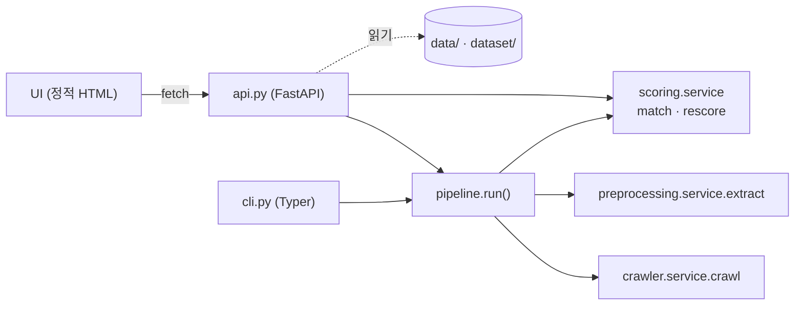

# 04. API · UI 설계

- 날짜: 2026-10-12
- 상태: 구현 완료 (사용자 확인 대기)
- 단계: 진입점 ([architecture](../architecture.md)) — ①②③ 서비스를 API로 열고, 결과·근거를 화면으로 보여준다
- 구현 계획: [plans/2026-10-12-04-api-and-ui.md](../plans/2026-10-12-04-api-and-ui.md)
- 관련 ADR: [0002](../adr/0002-thin-entrypoints.md), [0019](../adr/0019-fastapi-synchronous.md), [0020](../adr/0020-static-single-page-ui.md), [0021](../adr/0021-end-to-end-run.md)

## 1. 목표

1. **한 번에 실행**: 공고 URL(또는 rec_idx) 하나로 수집 → 조건 추출 → 매칭까지 끝나는 CLI 명령과 API 엔드포인트.
2. **결과 확인 화면**: 랭킹과 점수 근거를 보여주는 간단한 UI. 화려할 필요 없이, "왜 이 점수인가"를 요건 → 판정 → 이력서 인용 → 공고 원본 조각까지 따라갈 수 있게.

새 로직은 만들지 않는다. API·UI는 스펙 01~03의 서비스 함수를 호출하는 얇은 어댑터다 (ADR-0002).

## 2. 배경 — 지금까지 있는 것

| 서비스 | 함수 | 산출물 |
|---|---|---|
| ① 수집 | `crawler.service.crawl(ref, settings, client=…)` | `data/postings/…/snapshot.json` |
| ② 전처리 | `preprocessing.service.extract(ref, settings, llm=…)` | `data/criteria/…/criteria.json`, `slices/*.png`, `transcript.md` |
| ③ 스코어링 | `scoring.service.match(ref, settings, llm=…, candidates_dir=…)` | `data/results/…/ranking.json` |

세 단계 모두 산출물이 있으면 재사용하고(`refresh`로 강제), LLM 응답은 캐시된다 (ADR-0014). 그래서 이미 처리한 공고는 API 호출이 즉시 끝난다.

## 3. 요구사항

### 기능

| # | 요구사항 |
|---|---|
| F1 | 파이프라인 함수 `pipeline.run(ref, settings, …)` — 수집 → 추출 → 매칭을 차례로 호출하고 `MatchResult`를 돌려준다 |
| F2 | CLI `jobfit run <URL|rec_idx>...` (`--refresh`: 매칭만 다시) — 결과 랭킹 표 출력 |
| F3 | API (FastAPI) — 아래 4장 엔드포인트. 응답은 기존 pydantic 모델 그대로 (새 DTO 없음) |
| F4 | 저장된 판정으로 **가중치만 바꿔 재집계**하는 엔드포인트 — LLM 호출 없음 (스펙 03 N2) |
| F5 | UI: API만 호출하는 정적 페이지 1장 (`/`) — 공고 목록, 추출 조건, 랭킹, 지원자별 근거, 가중치 조정 |
| F6 | CLI `jobfit serve` — API와 UI를 함께 띄운다 |
| F7 | 지원자 디렉터리를 설정으로 (`JOBFIT_CANDIDATES_DIR`, 기본 `dataset/candidates`) |

### 비기능

| # | 요구사항 |
|---|---|
| N1 | API·UI에 비즈니스 로직 없음 — 서비스 함수 호출과 형식 변환만 |
| N2 | API 테스트는 네트워크·LLM 없이 (FastAPI `TestClient` + 기존 대역) |
| N3 | UI는 빌드 단계 없음 (Node 불필요). 외부 CDN 없이 오프라인에서 열린다 |
| N4 | 의도 라벨(`meta.label`)은 "평가용"으로 구분해 표시하고, 기본은 숨긴다 — 채용 담당자 화면에 정답이 섞이지 않게 |
| N5 | 로컬 단일 사용자 데모 범위 — 인증·동시 실행 제어 없음 (11장) |

## 4. API

| 메서드 | 경로 | 설명 | 응답 |
|---|---|---|---|
| GET | `/api/postings` | 조건이 추출된 공고 목록 + 매칭 여부 | `[PostingSummary]` |
| GET | `/api/postings/{id}/criteria` | 추출된 조건 | `PostingCriteria` |
| GET | `/api/postings/{id}/slices/{n}` | 근거 위치의 공고 이미지 조각 (`evidence.slice_index` = n) | PNG |
| GET | `/api/postings/{id}/result` | 저장된 매칭 결과 | `MatchResult` |
| POST | `/api/postings/{id}/match` | 매칭 실행 `{refresh: bool}` | `MatchResult` |
| POST | `/api/postings/{id}/rescore` | 가중치만 바꿔 재집계 `Weights` (저장하지 않음) | `MatchResult` |
| POST | `/api/run` | 한 번에 실행 `{ref: URL|rec_idx, refresh: bool}` | `MatchResult` |
| GET | `/api/candidates` | 지원자 목록 + 렌더링된 이력서 줄 + 평가용 라벨 | `[CandidateView]` |
| GET | `/` | UI | HTML |

```python
class PostingSummary:            # API 전용 목록 항목 (criteria + result에서 계산)
    posting_id: str
    title: str
    company: str | None
    job_family: str
    requirements: int; must: int; preferred: int; positions: int
    suitable: bool
    matched_at: str | None       # 매칭 결과가 있으면

class CandidateView:
    id: str; name: str; headline: str
    lines: list[str]             # render_lines() — 판정 LLM이 본 그대로 (줄 번호 = 인덱스 + 1)
    target_posting: str | None   # meta — 평가용
    label: str | None            # meta — 평가용
```

- `slices/{n}`: 조각 파일은 `slices/{이미지}_{조각}.png`이고, `n`은 전사의 조각 일련번호(`<!-- slice NN … -->`)다. 파일 이름 정렬 순서 = 일련번호 순서다 (이미지 순 → 조각 순으로 만들어짐).
- 오류: 서비스의 `RuntimeError`·`ValueError`(조건 없음, 평가할 요건 없음, 이력서 형식) → 400 + 메시지. 결과·조건 없음 → 404. LLM·네트워크 오류 → 502.
- `rescore`는 결과 파일을 바꾸지 않는다 — UI 슬라이더용 "만약" 계산.

## 5. UI

한 페이지, 세 영역. 정적 HTML + 바닐라 JS + `fetch` (ADR-0020).

```
┌──────────────────────────────────────────────────────────────────────────┐
│ jobfit   [ 공고 URL 또는 rec_idx      ] [실행]     공고: [S-OIL ▾][오리온]   │
├──────────────────────────┬───────────────────────────────────────────────┤
│ 공고 조건                 │ 랭킹                       □ 평가용 의도 라벨 표시 │
│ 2026년 S-OIL 사무직 …     │ 1  93 ████████▉  김하늘   재무    필수 5/5  ✓   │
│ 필수                      │ 2  93 ████████▉  이서윤   공정    필수 6/6      │
│  · 대학(원) 기졸업 … [원본]│ 3  69 ██████▉    정민수   영업    필수 4/5  ⚠1  │
│  · 공인영어성적 …   [원본]│ …                                             │
│ 우대                      │ 가중치  필수 비중 [0.7]  미충족 게이트 [0.8]      │
│  · 영어 회화 능통자        ├───────────────────────────────────────────────┤
│ 법정 우대 (점수 미반영)    │ 정민수 — 69점 (영업/마케팅)                      │
│  · 장애인 및 보훈 …        │ · 필수 5개 중 4개 충족 · 우대 2개 중 2개 충족       │
│ 근무조건 (참고)            │ · 미충족: [필수] 대학(원) … (이력서: "…2027-08") │
│  · 서울 / 울산             │ 요건            판정    근거(이력서)     기여     │
│                           │ 대학(원) …      미충족  학사 · … 2027-08  0.0     │
│ [원본 조각 이미지]          │ 공인영어성적    충족    TOEIC 880         11.2    │
│                           │ 이력서 원문 (인용된 줄 강조)                      │
└──────────────────────────┴───────────────────────────────────────────────┘
```

| 영역 | 내용 | 근거 추적 |
|---|---|---|
| 공고 조건 | 필수/우대 요건(유형·모집분야), 법정 우대(점수 미반영 표시), 근무조건(참고), 경고 | 요건의 [원본] → 해당 조각 이미지와 인용 문구 |
| 랭킹 | 순위·점수 막대·지원자·대표 분야·필수 충족·확인 필요 수, (선택) 평가용 라벨 | 행 클릭 → 상세 |
| 지원자 상세 | 템플릿 요약, 요건별 판정 표(상태·인용·사유·기여), 분야별 점수, 이력서 원문 | 인용된 이력서 줄 강조 |
| 가중치 | 필수 비중, 미충족 게이트, 부분·확인 필요 점수 슬라이더 → `rescore` | 바꾼 값으로 즉시 재랭킹 (LLM 호출 없음) |

- 상태 색: 충족 초록, 부분 노랑, 미충족 빨강, **확인 필요 파랑**(면접·서류 확인 대상), 해당 없음 회색.
- 실행 중에는 버튼을 막고 진행 문구를 보인다 (동기 요청 — 처음 처리하는 공고는 1~2분).

## 6. 설계



| 모듈 | 책임 |
|---|---|
| `pipeline.py` | `run(ref, settings, *, llm, client, candidates_dir, refresh, log)` — 세 서비스를 순서대로 |
| `scoring/service.py` (추가) | `rescore(result, weights) -> MatchResult` — 저장된 판정으로 재집계·재정렬 |
| `api.py` | `create_app(settings=None, llm=None) -> FastAPI` — 엔드포인트, 오류 변환, 정적 파일 |
| `web/index.html` | UI (HTML·CSS·JS 한 파일) |
| `cli.py` (추가) | `run`, `serve` |
| `settings.py` (추가) | `candidates_dir` |

`create_app`이 `settings`·`llm`을 받으므로 테스트는 임시 디렉터리와 `FakeLLM`으로 앱을 만든다.

## 7. 테스트

| 테스트 | 고른 이유 |
|---|---|
| `pipeline.run`이 수집 → 추출 → 매칭 순서로 같은 ref를 넘김 | "한 번에 실행" 요구의 핵심 |
| `rescore`: 가중치를 바꾸면 점수·순위가 바뀌고 LLM 호출 0, 기여 합 = 점수 유지 | 판정·집계 분리(ADR-0015)가 API에서도 유지되는지 |
| API: 공고 목록·조건·결과 200/404, 매칭 실행 후 결과 조회 | 어댑터가 서비스를 올바르게 호출 |
| API: 서비스 오류 → 400 + 메시지 | UI가 사용자에게 이유를 보여줄 수 있어야 함 |
| API: 조각 이미지 200(PNG)/404 | 근거 추적의 마지막 고리 |
| API: 지원자 목록의 `lines`에 `meta`가 없음, 라벨은 별도 필드 | 평가용 정보 분리 (N4) |
| `/`가 UI HTML을 돌려줌 | 서빙 경로 |

UI 동작은 단위 테스트하지 않고 수동 확인한다 (10장).

## 8. 오류 처리

| 상황 | API | UI |
|---|---|---|
| 조건 없음 / 결과 없음 | 404 | "먼저 실행" 안내 |
| 평가할 요건 없음, 이력서 형식 오류, rec_idx 해석 실패 | 400 + 메시지 | 메시지 표시 |
| 사람인·OpenAI 오류 | 502 + 메시지 | 메시지 표시, 다시 시도 |

## 9. 인터페이스

```bash
jobfit run https://www.saramin.co.kr/zf_user/jobs/relay/view?rec_idx=55162188   # 한 번에
jobfit run 55189170 55162188 --refresh      # 매칭만 다시 (수집·추출은 재사용)
jobfit serve                                 # http://127.0.0.1:8000
jobfit serve --port 8080 --host 0.0.0.0
```

## 10. 수용 기준

- [x] `pytest`가 네트워크·API 키 없이 통과
- [ ] `jobfit run <URL>` 한 번으로 새 공고의 수집 → 추출 → 매칭 결과가 출력됨 (이미 처리한 공고는 API 호출 0회)
- [x] `jobfit serve` 후 브라우저에서: 공고 전환, 요건의 원본 조각 보기, 랭킹, 지원자 상세(인용 줄 강조), 가중치 슬라이더 재랭킹이 동작 (헤드리스 확인, 12장)
- [ ] UI에서 공고 URL을 입력해 실행할 수 있음
- [x] 평가용 라벨은 기본 숨김, 토글로만 표시

## 11. 범위 밖

- 인증·권한, 여러 사용자, 작업 큐(비동기 실행)·진행률 스트리밍 — 운영 구조는 README의 고객사 경유 아키텍처에서 다룬다
- 이력서 업로드 UI (이력서 전처리 단계가 없음 — ADR-0016)
- 결과 내보내기(CSV 등), 다국어
- 고객사 경유 데이터 유입 구조 문서 (README, 다음 작업)

## 12. 관찰 기록

### 구현 (2026-10-12)

- 테스트 153개 (API 7, pipeline 3, CLI run·serve 포함) — 네트워크·API 키 없이 통과.
- 실제 데이터(공고 2건, 지원자 12명, 판정 gpt-4.1 결과)로 서버를 띄우고 헤드리스 Chromium으로 확인: 공고 탭 전환, 요건의 원본 조각 모달(S-OIL 모집분야 표 조각과 인용 문구), 랭킹, 지원자 상세(요건별 판정·인용·기여, 인용된 이력서 줄 강조), 평가용 라벨 토글, 가중치 슬라이더 재랭킹(필수 비중 0.3 → 정민수 69 → 75점, "가중치 변경 중 (저장되지 않음)" 표시). 콘솔 오류 0.
- 첫 화면 확인에서 발견해 고친 것: 배열 자식을 `replaceChildren`에 그대로 넘겨 `[object HTMLHeadingElement]`가 찍힘 → 자식을 펼쳐 넣는 `fill()`로 통일. 긴 모집분야 칩이 좌측 패널을 넘침 → 줄바꿈 허용.
- 계획과 달라진 점: `/api/run`은 `ref`를 먼저 해석해, 잘못된 입력이면 네트워크 요청 전에 400을 돌려준다.
- 사용자 확인 중 발견 (공고 55226797, 고려대 세종캠퍼스 사무직): "평가할 요건이 없음 (suitable=False)"만 보여 원인을 알 수 없었다. 이 공고는 본문이 텍스트(1,722자)이고 본문 이미지가 없다(워터마크만 제외됨) — 설계대로 조건 0개였지만, `run`이 수집에서 이미 알 수 있던 사실을 추출·매칭까지 끌고 간 뒤 모호한 메시지로 실패했다. 보정: `pipeline.run`이 수집 직후 본문 이미지가 없으면 "이미지 공고가 아님 — 본문이 텍스트(N자)이고 본문 이미지가 없음"으로 멈춤, 매칭의 "평가할 요건 없음" 메시지에 추출 경고(원인)를 붙임, CLI는 이런 오류를 추적 정보 없이 메시지로 출력.
- 사용자 확인 중 발견 (공고 55240124, KT&G 계약사원): `quote_not_found` 두 종류.
  - 조건 추출: 구조화 LLM이 "·"(U+00B7)를 `\u0000b7`로 잘못 이스케이프해 인용이 NUL 문자 + "b7"로 시작 → 전사에서 못 찾음. 보정: LLM 출력의 깨진 `\u00XX` 이스케이프를 복구하고 남은 제어 문자를 버리는 `clean_text()`를 인용·요건 문구에 적용.
  - 판정: "확인 필요" 판정에 이력서가 아니라 **공고 문구**("해외여행에 결격 사유가 없는 자")를 인용으로 붙임 → 인용 검증 실패 표시. 상태가 이미 확인 필요라 점수 영향은 없었다. 보정: 확인 필요 판정의 틀린 인용은 표시 없이 버리고, 점수에 영향을 주는 상태(충족·부분·미충족·해당 없음)에서만 확인 필요로 내리고 표시.
  - 기존 결과는 `jobfit extract … --refresh` 후 `jobfit match …`로 다시 만들면 된다 — LLM 캐시만 써서 API 호출 0회 (확인함, 3개 공고 모두 표시 0건).
- 화면에서 보인 것: 오리온 r2 "야간근무 가능자"에 `quote_not_found` 표시 — 이 `criteria.json`이 스펙 02의 "이어 붙인 인용 인정"(quote_spliced) 보정 **이전**에 만들어졌기 때문이다. `jobfit extract 55162188 55189170 --refresh`로 다시 만들면(LLM 캐시 적중, 호출 0) 사라진다. 조건이 다시 추출되면 매칭도 자동으로 다시 계산된다(Task 2 — 판정은 캐시).
